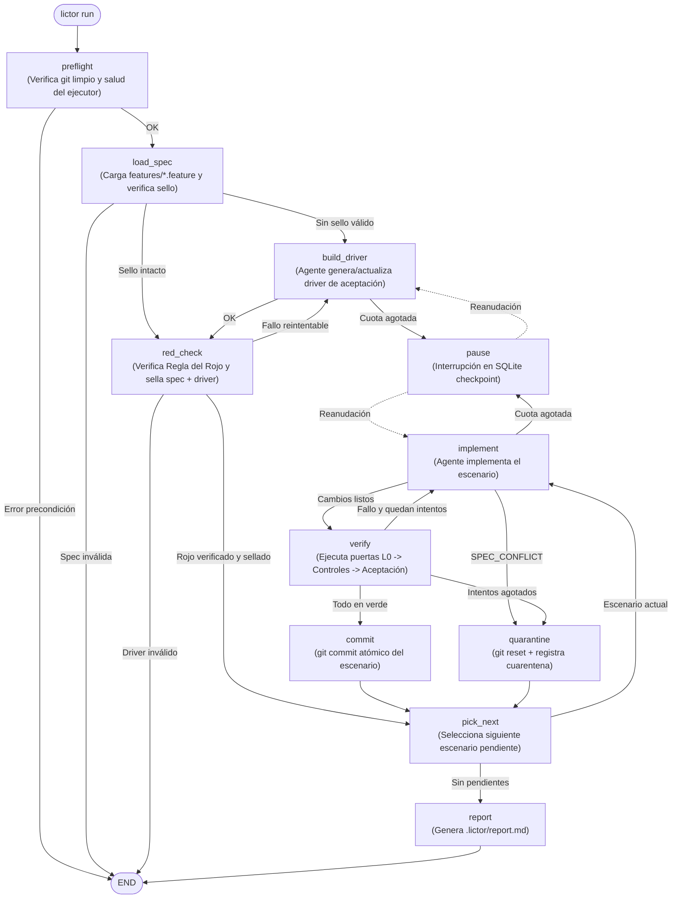
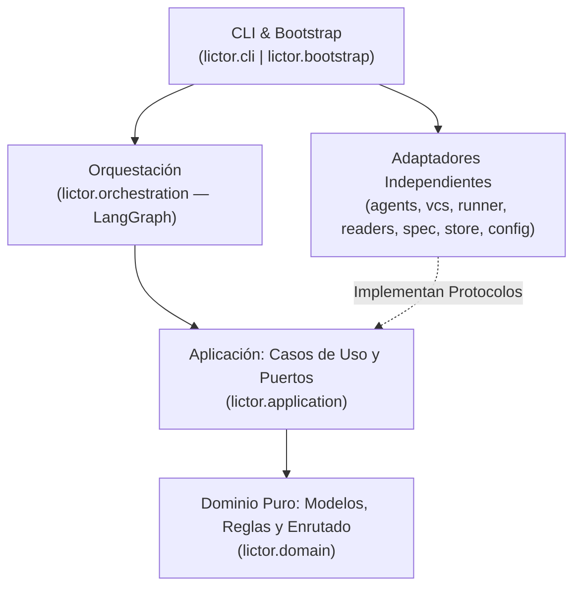

# Lictor

[](https://www.python.org/)
[](https://github.com/astral-sh/uv)
[](https://github.com/astral-sh/ruff)
[](https://mypy-lang.org/)
[](docs/adr/ADR-0002-arquitectura-hexagonal.md)

**Lictor** es un arnés determinista y entorno de ejecución agéntico que implementa escenarios de aceptación escritos en **Gherkin** mediante un agente autónomo de programación, verificando sistemáticamente cada entrega a través de puertas de calidad multinivel (`L0`–`L5`).

---

## Tabla de Contenidos

- [Visión General](#-visión-general)
- [Características Principales](#-características-principales)
- [Ciclo de Ejecución](#-ciclo-de-ejecución)
- [Requisitos e Instalación](#-requisitos-e-instalación)
- [Guía de Inicio Rápido](#-guía-de-inicio-rápido)
- [Referencia de la CLI](#-referencia-de-la-cli)
  - [Comandos Disponibles](#comandos-disponibles)
  - [Códigos de Salida](#códigos-de-salida)
- [Configuración (`lictor.json`)](#-configuración-lictorjson)
- [Puertas de Calidad (`L0`–`L5`)](#-puertas-de-calidad-l0l5)
- [Arquitectura del Proyecto](#-arquitectura-del-proyecto)
- [Desarrollo y Contribución](#-desarrollo-y-contribución)

---

## 🎯 Visión General

Los agentes de codificación autónomos son potentes pero propensos a modificar archivos fuera de alcance, introducir supresiones de linter para ocultar errores, alterar los propios tests de aceptación para forzar que pasen o degradar la arquitectura del proyecto.

**Lictor** invierte el control: el agente propone cambios en el código de producción y pruebas unitarias, pero **un arnés determinista gobierna el flujo completo**:

1. **Valida y sella** las especificaciones Gherkin (`features/*.feature`) y el *driver* de aceptación (`SHA-256`).
2. **Exige la Regla del Rojo (TDD):** verifica que los escenarios pendientes tengan un test ejecutable que falle antes de permitir su implementación.
3. **Acota el radio de acción del agente:** revierte cualquier modificación en rutas protegidas, bloquea supresiones (`# noqa`, `# type: ignore`, `# pragma: no cover`) y vigila la integridad del estado interno.
4. **Verifica en cascada (`L0` → `L5`):** ejecuta linters, chequeo estricto de tipos, tests unitarios, controles de arquitectura y la suite de aceptación comprobando la **no regresión** de los escenarios previos.
5. **Consolida o aísla:** realiza un `git commit` atómico por cada escenario en verde, o revierte el árbol y pone el escenario en **cuarentena** si agota sus intentos o presenta un conflicto de especificación.

---

## ✨ Características Principales

- **Ciclo Rojo → Verde Determinista:** Generación asistida del *driver* de aceptación (`pytest-bdd`), comprobación automática de la regla del rojo y sellado criptográfico en `.lictor/seal.json`.
- **Protección de Fronteras (`L0`):** Control estricto de rutas escribibles vs. protegidas, detección de supresiones en las líneas añadidas del diff e instantánea de integridad en memoria ([ADR-0001](docs/adr/ADR-0001-estado-en-dot-lictor.md)).
- **Orquestación Resiliente con Checkpoints:** Grafo de estados gestionado con **LangGraph** y persistido en SQLite (`.lictor/checkpoints.sqlite`). Si la suscripción o API alcanza un límite de cuota (`rate_limited`), la ejecución se pausa de forma limpia y se reanuda exactamente en el nodo pendiente al volver a invocar `lictor run`.
- **Detección de Conflictos de Especificación:** Si un escenario es contradictorio o imposible de satisfacer sin romper garantías previas, el agente puede emitir la señal `LICTOR: SPEC_CONFLICT <motivo>`, aislando el escenario inmediatamente sin consumir reintentos inútiles.
- **Auditoría CloudEvents 1.0 e Informes Markdown:** Bitácora estructurada en `.lictor/journal.jsonl` y generación de reportes ejecutivos en `.lictor/report.md` con desglose de intentos, tokens (entrada/salida/caché), coste en USD, tiempos de agente/verificación y hash de commit por escenario.
- **Arquitectura Hexagonal Estricta:** Dominio 100 % puro sin dependencias de frameworks ni E/S, con contratos de capas verificados automáticamente mediante `import-linter` ([ADR-0002](docs/adr/ADR-0002-arquitectura-hexagonal.md), [ADR-0003](docs/adr/ADR-0003-langgraph-adaptador-orquestacion.md)).

---

## 🔄 Ciclo de Ejecución

El motor de orquestación recorre un grafo de 11 nodos con persistencia transaccional en cada transición:



---

## 📦 Requisitos e Instalación

### Requisitos Previos

- **Python** `>= 3.12`
- **[uv](https://docs.astral.sh/uv/)** (gestor de paquetes y entornos virtuales)
- **Git** instalado y disponible en el `PATH`
- **[Claude Code CLI](https://docs.anthropic.com/en/docs/agents-and-tools/claude-code/overview)** (`claude`) instalado y autenticado (cuando se utiliza el backend `claude-cli` por defecto)

### Instalación desde el repositorio

```bash
# Clonar el repositorio
git clone <url-del-repositorio>
cd lictor

# Sincronizar el entorno e instalar todas las dependencias (incluyendo grupo dev)
uv sync --all-groups

# Verificar que la CLI responde correctamente
uv run lictor --help
```

Opcionalmente, para instalar `lictor` como herramienta global en tu usuario:

```bash
uv tool install --editable .
```

---

## 🚀 Guía de Inicio Rápido

### 1. Definir escenarios Gherkin

En el directorio `features/` de tu proyecto, crea un archivo `.feature` donde cada escenario tenga una etiqueta única con el formato `@<PREFIJO>-<NÚMERO>` (por ejemplo, `@IVA-001`):

```gherkin
# features/iva.feature
# language: es
Característica: IVA de una factura

  @IVA-001
  Escenario: IVA general
    Dado una factura con importe 100
    Cuando calculo el IVA general
    Entonces el total es 121

  @IVA-002
  Escenario: IVA reducido
    Dado una factura con importe 100
    Cuando calculo el IVA reducido
    Entonces el total es 110
```

> [!TIP]
> El repositorio incluye un proyecto de ejemplo listo para explorar en `examples/demo-iva/`.

### 2. Inicializar la configuración de Lictor

Detecta automáticamente el perfil del proyecto (por ejemplo `python-uv@0.1`) y genera `lictor.json`:

```bash
uv run lictor init
```

### 3. Comprobar precondiciones con `doctor`

Verifica que `lictor.json` sea válido, el árbol de trabajo de `git` esté limpio, el ejecutor del agente esté disponible y los binarios de todos los controles existan:

```bash
uv run lictor doctor
```

### 4. Ejecutar la implementación y verificación autónoma

```bash
uv run lictor run
```

Si la ejecución se interrumpe o se pausa por límite de cuota (código `50`), basta con volver a ejecutar `uv run lictor run` para reanudarla desde el último checkpoint. Para descartar el estado previo y forzar una ejecución desde cero, usa `uv run lictor run --new`.

### 5. Consultar el estado y el informe

```bash
# Ver el estado actual en consola o en formato JSON
uv run lictor status
uv run lictor status --json

# Regenerar y obtener la ruta del informe en Markdown (.lictor/report.md)
uv run lictor report
```

---

## 🛠️ Referencia de la CLI

### Comandos Disponibles

| Comando | Opciones Principales | Descripción |
| :--- | :--- | :--- |
| `lictor init` | `--profile, -p <nombre>`<br/>`--model, -m <id>`<br/>`--force, -f` | Inicializa `lictor.json` en el repositorio detectando el perfil o aplicando el indicado, y actualiza `.gitignore`. |
| `lictor doctor` | — | Comprueba las precondiciones del entorno (configuración, árbol git limpio, salud del agente y binarios de controles) sin ejecutar el grafo. |
| `lictor check` | `--level, -l <niveles>` | Ejecuta los controles deterministas (filtrables por coma, ej. `--level L1,L2`) y la suite de aceptación sobre el árbol actual. |
| `lictor run` | `--new` | Ejecuta o reanuda el grafo determinista para implementar y verificar todos los escenarios Gherkin. |
| `lictor status` | `--json` | Muestra el estado de la ejecución actual a partir del checkpoint SQLite y la bitácora. |
| `lictor report` | `--run <run_id>` | Regenera el informe `.lictor/report.md` a partir de `.lictor/journal.jsonl` y muestra su ruta. |

### Códigos de Salida

Lictor garantiza códigos de salida estables para su integración en pipelines de CI/CD y scripts de automatización:

| Código | Nombre | Significado |
| :---: | :--- | :--- |
| `0` | `OK` | Ejecución completada con éxito; todos los escenarios o controles pasaron en verde. |
| `1` | `INTERNAL_ERROR` | Error interno inesperado del runtime. |
| `10` | `PRECONDITION` | Precondición incumplida: árbol `git` sucio, configuración/perfil inválido, spec o driver inválido, o sello alterado (`SealTamperedError`). |
| `11` | `SPEC_CONFLICT` | Al menos un escenario entró en cuarentena porque el agente declaró conflicto o imposibilidad en la especificación (`LICTOR: SPEC_CONFLICT`). |
| `30` | `QUARANTINED` | Al menos un escenario quedó en cuarentena por agotar el número máximo de intentos (`max_attempts`). |
| `50` | `RATE_LIMITED` | Ejecución pausada en checkpoint por límite de cuota de la suscripción/API. Reanudable ejecutando `lictor run`. |

---

## ⚙️ Configuración (`lictor.json`)

El archivo `lictor.json` en la raíz del proyecto define el perfil base, el backend del agente, los límites de intentos, las fronteras de archivos y los controles de verificación. Su esquema formal JSON Schema se encuentra en [`schema/lictor.schema.json`](schema/lictor.schema.json).

Cuando se especifica un `"profile"` (como `"python-uv@0.1"`), Lictor hereda automáticamente los valores por defecto del perfil para cualquier sección omitida.

### Ejemplo completo de `lictor.json`

```json
{
  "version": "0.1",
  "profile": "python-uv@0.1",
  "backend": {
    "kind": "claude-cli",
    "model": "claude-sonnet-4-5-20250929",
    "auth": "subscription",
    "max_turns": 40,
    "timeout_s": 1800
  },
  "limits": {
    "max_attempts": 3,
    "max_driver_attempts": 2,
    "error_max_chars": 4000
  },
  "paths": {
    "writable": ["src/", "tests/unit/"],
    "driver": ["tests/acceptance/"],
    "protected": ["features/", "tests/acceptance/", "lictor.json", "pyproject.toml", "uv.lock"]
  },
  "acceptance": {
    "run": "uv run pytest tests/acceptance -q --junitxml {out}",
    "report": "junit",
    "timeout_s": 600
  },
  "controls": [
    {"id": "lint",  "level": "L1", "run": "uv run ruff check src", "report": "exit-code", "mode": "block"},
    {"id": "types", "level": "L1", "run": "uv run mypy src", "report": "exit-code", "mode": "block"},
    {"id": "unit",  "level": "L2", "run": "uv run pytest tests/unit -q --junitxml {out}", "report": "junit", "mode": "block", "allow_empty": true}
  ],
  "suppressions": ["# noqa", "# type: ignore", "# pragma: no cover"],
  "agent_tools": ["Bash(uv run pytest:*)", "Bash(uv run ruff:*)", "Bash(uv run mypy:*)"]
}
```

> [!IMPORTANT]
> - `backend.model` exige el identificador completo del modelo con versión (p. ej. `claude-sonnet-4-5-20250929`) para garantizar la reproducibilidad; no se permiten alias cortos como `sonnet` o `latest`.
> - `paths.writable` no puede solaparse nunca con `paths.protected` ni con `paths.driver`.
> - Todo control o suite de aceptación con `"report": "junit"` debe incluir el marcador `{out}` en su comando `run`.

### Artefactos de estado en `.lictor/`

Durante su ejecución, Lictor gestiona su estado interno dentro del directorio `.lictor/` (ignorado por `git`):

- `current_run`: identificador de la ejecución activa.
- `checkpoints.sqlite`: estado persistido del grafo LangGraph (`PRAGMA synchronous = FULL`).
- `seal.json`: hashes `SHA-256` de los archivos `.feature` y del *driver* de aceptación.
- `journal.jsonl`: bitácora append-only de eventos en formato CloudEvents 1.0.
- `report.md`: informe ejecutivo en Markdown de la última ejecución.
- `runs/<run_id>/`: salidas crudas del agente y reportes JUnit XML de cada control.

---

## 🛡️ Puertas de Calidad (`L0`–`L5`)

Cada intento de implementación supera una tubería secuencial determinista:

| Nivel | Puerta | Verificación | Modo habitual |
| :---: | :--- | :--- | :---: |
| **L0** | `L0-rutas` | Comprueba que el agente solo haya tocado `paths.writable`. Si modificó rutas protegidas, las revierte automáticamente y falla el intento. | `block` |
| **L0** | `L0-sello` | Verifica que ningún archivo en `features/` ni en `paths.driver` haya cambiado respecto a `.lictor/seal.json`. | `block` |
| **L0** | `L0-supresiones` | Inspecciona las líneas añadidas en el diff y archivos nuevos buscando directivas prohibidas (`# noqa`, `# type: ignore`, `# pragma: no cover`). | `block` |
| **L0** | `L0-estado` | Instantánea en memoria de `.lictor/` y `lictor.json` antes y después de ejecutar comandos de terceros; restaura y falla si detecta manipulación. | `block` |
| **L1** | Análisis estático | Linters (`ruff check`), formato (`ruff format --check`) y tipado estático estricto (`mypy --strict`). | `block` |
| **L2** | Tests unitarios | Suite de pruebas unitarias aisladas (`pytest tests/unit`). | `block` |
| **L3** | Aceptación | Ejecuta la suite de aceptación, mapea los casos de prueba a los IDs de escenario y exige que el escenario actual pase **y todos los escenarios previamente en verde sigan pasando**. | `block` |
| **L4** | Arquitectura, cobertura y seguridad | Contratos de capas (`lint-imports`), cobertura de ramas (`>= 90 %` global, `>= 95 %` en dominio), auditoría de vulnerabilidades (`pip-audit`) y detección de secretos (`gitleaks`). | `block` |
| **L5** | Mutación | Pruebas de mutación sobre el dominio (`mutmut`) para medir la efectividad real de los tests unitarios. | `measure` / `block` |

---

## 🏗️ Arquitectura del Proyecto

Lictor está construido siguiendo **Arquitectura Hexagonal (Puertos y Adaptadores)**. Las dependencias apuntan estrictamente hacia el interior y se validan mediante `.importlinter`:



### Estructura del Repositorio

```text
├── pyproject.toml              # Configuración del paquete y herramientas (ruff, mypy, pytest, mutmut)
├── lictor.json                 # Configuración de puertas de calidad del propio repositorio Lictor
├── .importlinter               # Contratos de arquitectura hexagonal
├── schema/
│   └── lictor.schema.json      # JSON Schema formal de lictor.json
├── docs/
│   └── adr/                    # Architecture Decision Records (ADR-0001 a ADR-0003)
├── examples/
│   └── demo-iva/               # Proyecto de ejemplo con escenarios Gherkin en español
├── src/lictor/
│   ├── domain/                 # Dominio puro: model.py, rules.py, routing.py, errors.py
│   ├── application/
│   │   ├── ports.py            # Puertos (Protocolos: Executor, Vcs, CommandRunner, EventLog, etc.)
│   │   ├── seal.py             # Cálculo y validación del sello SHA-256
│   │   └── usecases/           # Interactors de casos de uso (prepare_driver, check_red, verify_attempt...)
│   ├── adapters/
│   │   ├── agents/             # Ejecutores de agente (ClaudeCLI, FakeExecutor)
│   │   ├── vcs/                # Adaptador de control de versiones (GitCli)
│   │   ├── runner/             # Ejecución de subprocesos (SubprocessRunner, FakeRunner)
│   │   ├── readers/            # Lectores de resultados (ExitCodeReader, JUnitReader con defusedxml)
│   │   ├── spec/               # Parser oficial de Gherkin (GherkinSource)
│   │   ├── store/              # Bitácora CloudEvents JSONL y reloj del sistema
│   │   └── config/             # Modelos Pydantic, cargador de configuración y perfiles
│   ├── orchestration/          # Grafo de estados LangGraph y checkpointer SQLite
│   ├── prompts/                # Plantillas de prompts del sistema (driver.md, implement.md)
│   ├── bootstrap.py            # Raíz de composición e inyección de dependencias
│   └── cli.py                  # Punto de entrada CLI con Typer
└── tests/
    ├── unit/                   # Pruebas unitarias rápidas de dominio, casos de uso y adaptadores
    └── integration/            # Pruebas de integración extremo a extremo y contratos de arquitectura
```

### Decisiones de Arquitectura (ADRs)

- **[ADR-0001](docs/adr/ADR-0001-estado-en-dot-lictor.md):** El estado vive en `.lictor/`, dentro del repositorio e ignorado por git.
- **[ADR-0002](docs/adr/ADR-0002-arquitectura-hexagonal.md):** Arquitectura Hexagonal (Puertos y Adaptadores).
- **[ADR-0003](docs/adr/ADR-0003-langgraph-adaptador-orquestacion.md):** LangGraph como adaptador de orquestación, no núcleo del sistema.

---

## 🧪 Desarrollo y Contribución

Lictor se verifica a sí mismo utilizando sus propias puertas de calidad configuradas en `lictor.json`. Todos los comandos deben ejecutarse desde la raíz del repositorio con `uv`:

### Verificación con un solo comando

```bash
# Ejecutar controles de niveles L1 y L2
uv run lictor check --level L1,L2

# Ejecutar todos los controles (L1, L2, L4, L5) y la suite de aceptación
uv run lictor check
```

### Comandos individuales de calidad

```bash
# L1: Estilo, formato y tipado estricto
uv run ruff check .
uv run ruff format --check .
uv run mypy --strict src

# L2: Pruebas unitarias
uv run pytest tests/unit -q

# L3: Pruebas de integración y aceptación
uv run pytest tests/integration -q

# L4: Contratos de arquitectura y cobertura de ramas (>= 90% global, >= 95% dominio)
uv run lint-imports
uv run pytest tests --cov=lictor --cov-branch --cov-fail-under=90 -q
uv run coverage report --include="*/lictor/domain/*" --fail-under=95

# L4: Auditoría de seguridad y detección de secretos
uvx pip-audit
gitleaks detect --no-banner

# L5: Pruebas de mutación sobre el dominio
uv run mutmut run
```

### Convenciones del código

- **Python `>= 3.12`:** uso de sintaxis moderna de tipos (`X | Y`, `list[T]`, `dict[K, V]`).
- **Tipado estricto:** todas las funciones y métodos deben incluir anotaciones explícitas de parámetros y retorno (`mypy --strict`).
- **Cero supresiones:** evita comentarios `# noqa`, `# type: ignore` o `# pragma: no cover`.
- **Pureza de capas:** `lictor.domain` y `lictor.application` nunca deben importar `pydantic`, `typer`, `langgraph` ni adaptadores concretos.

