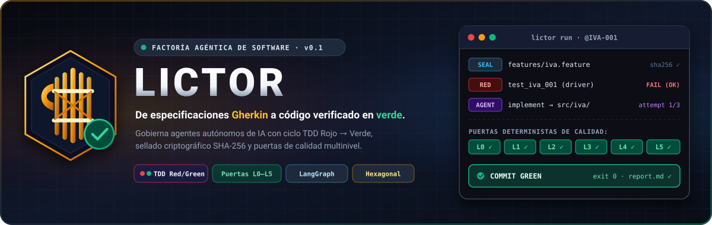
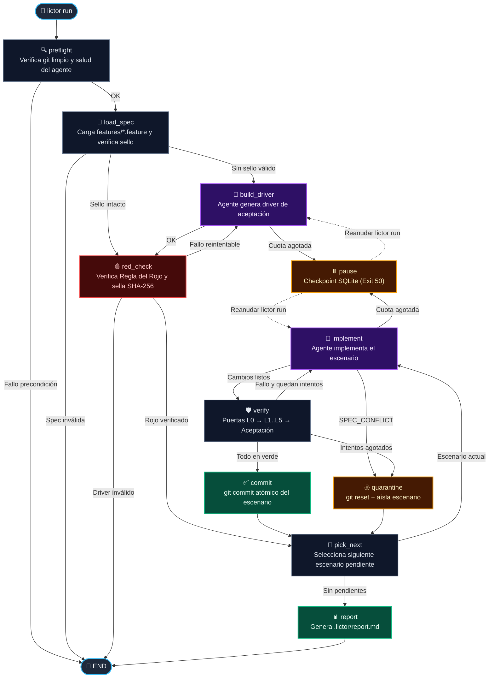
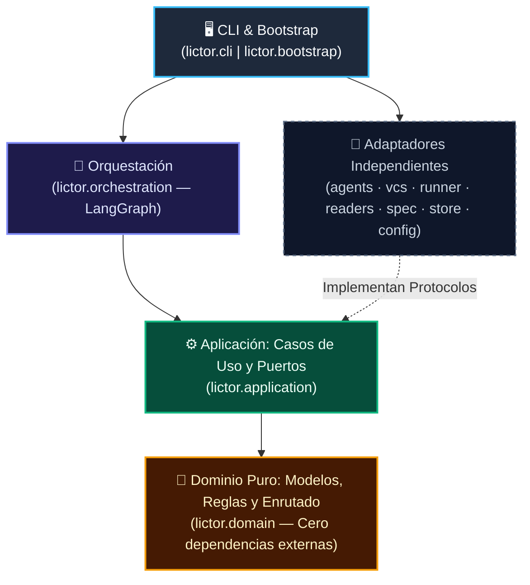

<div align="center">



<br/>

[](https://www.python.org/)
[](https://docs.astral.sh/uv/)
[](https://langchain-ai.github.io/langgraph/)
[](https://docs.astral.sh/ruff/)
[](https://mypy-lang.org/)
[](docs/adr/ADR-0002-arquitectura-hexagonal.md)

<p align="center">
  <strong>Implementa escenarios Gherkin con un agente autónomo y los verifica de forma 100 % determinista.</strong><br/>
  <sub>Ciclo TDD Rojo → Verde · Sellado criptográfico SHA-256 · Puertas de calidad L0–L5 · Auditoría CloudEvents 1.0</sub>
</p>

<p align="center">
  <a href="#-por-qué-lictor">¿Por qué Lictor?</a> •
  <a href="#-ciclo-de-ejecución">Ciclo de Ejecución</a> •
  <a href="#-guía-de-inicio-rápido">Inicio Rápido</a> •
  <a href="#️-referencia-de-la-cli">CLI y Códigos</a> •
  <a href="#️-puertas-de-calidad-l0l5">Puertas L0–L5</a> •
  <a href="#️-arquitectura-del-proyecto">Arquitectura</a>
</p>

</div>

---

> **🏛️ ¿Por qué el nombre *Lictor*?**
> En la antigua Roma, los *lictores* escoltaban a los magistrados portando las *fasces*: un haz de varas atadas que simbolizaba el orden, la disciplina y la ejecución determinista de la ley. **Lictor** actúa como el escolta determinista de los agentes de IA: les permite escribir código con autonomía, pero los somete estrictamente a la ley de tu especificación y de tus puertas de calidad.

---

> [!WARNING]
> **El verde todavía no resiste a un agente adversario.** Hoy significa que ese commit exacto pasó los controles y la aceptación en un clon limpio, con un entorno comprobado por hash. Pero `.git`, `.lictor/` y ese entorno están al alcance del agente, que corre con tus permisos, y el clon parte de un `.git` que aún puede alterar. Eso sigue así hasta cerrar la Fase 4 del plan de corrección. Además hay una limitación conocida de la v0.1 que ninguna fase de este plan cierra: cualquier código del proyecto que se importe durante los tests corre en el mismo proceso que el runner, así que puede alterar el runner o forjar el informe de aceptación. Basta con que `src/` registre un plugin al importarse. Se cerrará con el sandbox del incremento 4. Hasta entonces el verde no resiste a un adversario, y `forbidden_paths` y `banned_patterns` son heurísticas: encarecen la trampa, no la impiden.
>
> Lo que sí está cerrado son vías concretas de carga antes de los tests: `src/` no entra en el arranque de Python, de modo que un `sitecustomize.py` no se ejecuta ni en `mypy` ni en `pytest`; un paquete en `src/` no sustituye a una dependencia, porque `src` va al final de la ruta; y las variables heredadas que cargan código (`PYTHONPATH`, `PYTHONSTARTUP`, `PYTEST_ADDOPTS` y similares) se limpian.

## ⚡ ¿Por qué Lictor?

Dejar a un agente de codificación suelto sobre un repositorio suele derivar en atajos indeseados. **Lictor** invierte el control: el agente propone el código, pero **un arnés inmutable decide qué entra al repositorio**.

| Problema habitual con agentes autónomos ❌ | Cómo lo gobierna Lictor 🛡️ |
| :--- | :--- |
| **Modifican los tests** para forzar que pasen en lugar de arreglar el código. | **Sellado SHA-256 (`L0-sello`):** las features Gherkin y el *driver* de aceptación quedan sellados en `.lictor/seal.json`. Cualquier alteración aborta o revierte el intento. |
| **Escriben tests que ya pasaban** sin probar realmente la nueva funcionalidad. | **Regla del Rojo (`red_check`):** antes de implementar un escenario pendiente, su test de aceptación está obligado a **fallar en rojo**. |
| **Silencian errores** añadiendo `# noqa`, `# type: ignore` o `# pragma: no cover`. | **Escáner de supresiones (`L0-supresiones`):** inspecciona cada línea añadida en el diff y rechaza el intento si detecta directivas prohibidas. |
| **Tocan archivos prohibidos** (`pyproject.toml`, configuración o estado interno). | **Fronteras de rutas (`L0-rutas` y `L0-estado`):** revierte automáticamente archivos fuera de `paths.writable` y protege `.lictor/` con instantáneas en memoria. |
| **Dejan el verde en ficheros que nadie versiona** (`.pyc` forjados, ficheros ignorados, plugins). | **Commit candidato en clon limpio:** los controles y la aceptación corren sobre lo que se va a commitear, con un entorno comprobado por hash. |
| **Rompen escenarios anteriores** al intentar arreglar el escenario actual. | **Verificación de no regresión (`L3`):** exige que pase el escenario actual **y** todos los escenarios que ya estaban en verde. |
| **Se quedan a medias** si se agota la cuota de suscripción o API. | **Checkpoints SQLite + Pausa limpia (`exit 50`):** guarda el estado exacto del grafo LangGraph y reanuda donde quedó al volver a ejecutar `lictor run`. |

---

## ✨ Características Principales

- 🔴🟢 **Ciclo Rojo → Verde Determinista:** Generación asistida del *driver* de aceptación (`pytest-bdd`), comprobación automática de la regla del rojo y sellado criptográfico en `.lictor/seal.json`.
- 🛡️ **Defensa en Profundidad (`L0`–`L5`):** Tubería secuencial desde integridad del arnés (`L0`), análisis estático y tipos estrictos (`L1`), tests unitarios (`L2`), aceptación sin regresiones (`L3`), arquitectura y seguridad (`L4`), hasta pruebas de mutación (`L5`).
- 🧬 **Aislamiento, Commits Atómicos y Cuarentena:** Cada escenario verificado produce un `git commit` limpio. Si un escenario agota sus intentos o el agente declara conflicto de especificación (`LICTOR: SPEC_CONFLICT`), Lictor hace `git reset` al último estado verde, pone el escenario en **cuarentena** y continúa con el resto.
- 📊 **Trazabilidad CloudEvents 1.0 e Informes Ejecutivos:** Bitácora append-only en `.lictor/journal.jsonl` y generación automática de `.lictor/report.md` con métricas de tokens, coste en USD, duración de agente vs. verificación y commits por escenario.
- 🏛️ **Arquitectura Hexagonal Pura:** Dominio 100 % libre de frameworks (`langgraph`, `pydantic`, `typer` prohibidos en el núcleo), blindado con contratos de `import-linter`.

---

## 🔄 Ciclo de Ejecución

El motor de orquestación ejecuta un grafo de estados de **11 nodos** con persistencia transaccional en SQLite (`PRAGMA synchronous = FULL`):



---

## 📦 Requisitos e Instalación

### Requisitos Previos

- **Sistema operativo:** Linux o macOS. **Windows no está soportado:** el entorno de verificación, los grupos de procesos y las rutas del perfil son POSIX.
- **Python** `>= 3.12`
- **[uv](https://docs.astral.sh/uv/)** (gestor de paquetes y entornos de Astral)
- **Git** instalado y disponible en `PATH`
- **[Claude Code CLI](https://docs.anthropic.com/en/docs/agents-and-tools/claude-code/overview)** (`claude`) autenticado *(para el backend por defecto `claude-cli`)*

### Instalación

```bash
# 1. Clonar el repositorio
git clone <url-del-repositorio>
cd lictor

# 2. Instalar dependencias de producción y desarrollo
uv sync --all-groups

# 3. Comprobar la CLI
uv run lictor --help
```

> [!TIP]
> También puedes instalar `lictor` como herramienta global en tu entorno de usuario con:
> ```bash
> uv tool install --editable .
> ```

---

## 🚀 Guía de Inicio Rápido

### 1️⃣ Escribe tus escenarios Gherkin en `features/`

Cada escenario debe ir etiquetado con un identificador único `@<PREFIJO>-<NÚMERO>` (por ejemplo, `@IVA-001`):

```gherkin
# features/iva.feature
# language: es
Característica: IVA de una factura

  @IVA-001
  Escenario: IVA general
    Dado una factura con importe 100
    Cuando calculo el IVA general
    Entonces el total es 121

  @IVA-002
  Escenario: IVA reducido
    Dado una factura con importe 100
    Cuando calculo el IVA reducido
    Entonces el total es 110

  @IVA-003
  Escenario: Importe negativo
    Dado una factura con importe -5
    Cuando calculo el IVA general
    Entonces se rechaza por importe no válido
```

> 💡 *Puedes explorar este proyecto de ejemplo directamente en el directorio [`examples/demo-iva/`](examples/demo-iva/).*

### 2️⃣ Inicializa y diagnostica el proyecto

```bash
# Detecta automáticamente el perfil (ej. python-uv@0.1) y crea lictor.json
uv run lictor init

# Verifica que el entorno, git, ejecutor y herramientas de control estén listos
uv run lictor doctor
```

```text
✓ Configuración válida: perfil 'python-uv@0.1'
✓ Árbol git limpio sin cambios pendientes
✓ Ejecutor disponible: claude 2.x.x (subscription)
✓ 3 controles configurados correctamente
Doctor: todas las comprobaciones pasaron con éxito.
```

### 3️⃣ Ejecuta el ciclo autónomo y consulta el informe

```bash
# Implementa y verifica todos los escenarios de forma determinista
uv run lictor run

# Consulta el estado actual de la ejecución
uv run lictor status

# Regenera y muestra la ruta del informe en Markdown (.lictor/report.md)
uv run lictor report
```

<details>
<summary>📄 <strong>Ver ejemplo de informe generado en <code>.lictor/report.md</code></strong></summary>

```markdown
# Informe de ejecución de Lictor

## Resumen
- **Escenarios en verde**: 3
- **Escenarios en cuarentena**: 0
- **Escenarios pendientes**: 0
- **Código de salida**: 0
- **Motivo**: Ejecución completada: 3 escenarios en verde
- **Duración total**: 18.42s

## Escenarios
| ID | Nombre | Estado | Intentos | Tokens (In/Out) | Coste | Tiempo Agente | Tiempo Verif | Commit |
|---|---|---|---|---|---|---|---|---|
| IVA-001 | IVA general | green | 1 | 4120 / 890 | $0.0257 | 5400ms | 620ms | a1b2c3d |
| IVA-002 | IVA reducido | green | 1 | 3850 / 640 | $0.0212 | 4800ms | 590ms | e4f5g6h |
| IVA-003 | Importe negativo | green | 1 | 4010 / 710 | $0.0227 | 6100ms | 910ms | i7j8k9l |

## Cuarentenas
- *Ningún escenario en cuarentena.*

## Intentos fallidos por nivel
- *Sin fallos registrados.*

## Verificaciones
| Escenario | Intento | Resultado | Error |
|---|---|---|---|
| IVA-001 | 1 | verde | - |
| IVA-002 | 1 | verde | - |
| IVA-003 | 1 | verde | - |

## Controles en medición
- *Ningún control en medición.*

## Drivers rechazados
- *Ningún driver rechazado.*
```

</details>

---

## 🛠️ Referencia de la CLI

### Comandos Disponibles

| Comando | Opciones | Descripción |
| :--- | :--- | :--- |
| `lictor init` | `--profile, -p <nombre>`<br/>`--model, -m <id>`<br/>`--force, -f` | Inicializa `lictor.json` en el repositorio detectando el perfil del proyecto (o aplicando el indicado) y actualiza `.gitignore`. |
| `lictor doctor` | — | Verifica las precondiciones del entorno (validez de `lictor.json`, árbol `git` limpio, salud del agente y binarios de controles) sin ejecutar el grafo. |
| `lictor check` | `--level, -l <niveles>` | Ejecuta los controles deterministas (filtrables por coma, p. ej. `--level L1,L2`) y la suite de aceptación sobre el árbol actual. |
| `lictor run` | `--new` | Ejecuta o reanuda el grafo determinista desde el último checkpoint para implementar y verificar todos los escenarios. |
| `lictor status` | `--json` | Muestra el estado de la ejecución actual a partir del checkpoint SQLite y la bitácora de eventos. |
| `lictor report` | `--run <run_id>` | Regenera el informe `.lictor/report.md` a partir de `.lictor/journal.jsonl` y muestra su ruta. |

### Códigos de Salida Estables

Diseñados para integrarse de forma predecible en pipelines de CI/CD y scripts de automatización. Cada salida explica su motivo en stderr, en `.lictor/journal.jsonl` y en `.lictor/report.md`:

| Código | Constante (`ExitCode`) | Significado |
| :---: | :--- | :--- |
| **`0`** | `OK` | Todos los escenarios (o controles en `lictor check`) pasaron en verde. |
| **`1`** | `INTERNAL_ERROR` | Error interno inesperado del runtime. |
| **`10`** | `PRECONDITION` | Fallo de precondición: árbol `git` sucio, configuración inválida, spec/driver inválido o sello alterado (`SealTamperedError`). |
| **`11`** | `SPEC_CONFLICT` | Al menos un escenario entró en cuarentena porque el agente declaró contradicción o imposibilidad (`LICTOR: SPEC_CONFLICT`). |
| **`30`** | `QUARANTINED` | Al menos un escenario quedó en cuarentena tras agotar `max_attempts`. |
| **`40`** | `ENVIRONMENT_UNAVAILABLE` | No se pudo ejecutar por el entorno, al arrancar o a mitad de ejecución: el agente no tiene sesión o no responde, o no se pudo preparar el entorno de verificación. No es un fallo del trabajo y no penaliza escenarios: no gasta intentos ni pone nada en cuarentena. Arregla el entorno y relanza `lictor run`; `lictor doctor` dice qué falla. |
| **`50`** | `RATE_LIMITED` | Ejecución pausada en checkpoint por límite de cuota de la suscripción/API. Reanudable ejecutando `lictor run`. |

---

## 🛡️ Puertas de Calidad (`L0`–`L5`)

Las puertas L0 miran el árbol del agente. Los controles y la aceptación corren en un **clon limpio de un commit candidato**, fuera de la rama, y la rama avanza a ese SHA exacto solo si pasan: lo verificado es lo commiteado.

Cada intento del agente atraviesa una tubería de verificación secuencial que **corta en el primer fallo bloqueante** y condensa el error para alimentar el siguiente intento. El mensaje queda acotado por `limits.error_max_chars` y siempre conserva el motivo; el error completo va a `.lictor/runs/`. Los controles `measure` no bloquean, pero su resultado y su salida quedan registrados en `.lictor/journal.jsonl` y `.lictor/report.md`:

| Nivel | Puerta | Qué verifica | Modo |
| :---: | :--- | :--- | :---: |
| **L0** | `L0-rutas` | El agente solo puede modificar `paths.writable`. Cualquier cambio en rutas protegidas, en `forbidden_paths` o que sea un enlace simbólico se revierte automáticamente y falla el intento. | `block` |
| **L0** | `L0-sello` | Comprueba que ningún archivo en `features/` ni en `paths.driver` haya cambiado respecto a los hashes `SHA-256` de `.lictor/seal.json`. | `block` |
| **L0** | `L0-supresiones` | Analiza las líneas añadidas en el diff y archivos nuevos bloqueando `suppressions` y las expresiones de `banned_patterns`, sin distinguir mayúsculas: `# noqa`, `#type:ignore`, `# ruff: noqa`, `pytest.skip(`… | `block` |
| **L0** | `L0-estado` | Toma una instantánea en memoria de `.lictor/` y `lictor.json` antes y después de cada comando; si detecta manipulación, restaura y aborta ([ADR-0001](docs/adr/ADR-0001-estado-en-dot-lictor.md)). | `block` |
| **L0** | `L0-entorno` | Compara el hash del entorno de verificación, con todos sus ficheros, antes y después de ejecutar los comandos. Si no coincide, falla el intento, reconstruye el entorno y deja el evento `lictor.env.tampered.v1`. | `block` |
| **L1** | Análisis estático | Linter (`ruff check`), formato (`ruff format --check`) y chequeo estricto de tipos (`mypy --strict`). | `block` |
| **L2** | Pruebas unitarias | Ejecución rápida de tests unitarios aislados (`pytest tests/unit`) con lectura de JUnit XML. | `block` |
| **L3** | Aceptación y no regresión | Mapea cada test del reporte JUnit a su `@ID-NNN`: exige que el escenario actual pase **y que ningún escenario previamente en verde haya regresionado**. | `block` |
| **L4** | Arquitectura, cobertura y seguridad | Contratos de capas (`lint-imports`), cobertura de ramas (`>= 90 %` global, `>= 95 %` dominio), vulnerabilidades (`pip-audit`) y secretos (`gitleaks`). | `block` |
| **L5** | Mutación | Pruebas de mutación (`mutmut`) sobre el dominio para medir la fortaleza real de la suite unitaria. En GitHub Actions corre con `schedule` y `workflow_dispatch`, no en cada cambio. Hoy solo registra resultado y salida: `mutmut` termina con 0 aunque queden supervivientes, y Lictor aún no lee la puntuación. | `measure` |

---

## ⚙️ Configuración (`lictor.json`)

El archivo `lictor.json` define el perfil del proyecto, el backend del agente, los límites de intentos, las fronteras de rutas y los controles. Puedes consultar su esquema formal en [`schema/lictor.schema.json`](schema/lictor.schema.json).

> [!IMPORTANT]
> - **ID de modelo explícito:** `backend.model` exige el identificador completo con versión (p. ej. `claude-sonnet-4-5-20250929`) y rechaza alias mutables como `sonnet` o `latest`.
> - **Fronteras disjuntas:** `paths.writable` nunca puede solaparse con `paths.protected` ni con `paths.driver`.
> - **Marcador JUnit:** Todo control o suite de aceptación con `"report": "junit"` debe incluir `{out}` en su comando `run`.

<details>
<summary>⚙️ <strong>Ver ejemplo completo de <code>lictor.json</code> y estructura de <code>.lictor/</code></strong></summary>

### Ejemplo de `lictor.json`

```json
{
  "version": "0.1",
  "profile": "python-uv@0.1",
  "backend": {
    "kind": "claude-cli",
    "model": "claude-sonnet-4-5-20250929",
    "auth": "subscription",
    "max_turns": 40,
    "timeout_s": 1800
  },
  "limits": {
    "max_attempts": 3,
    "max_driver_attempts": 2,
    "error_max_chars": 4000
  },
  "paths": {
    "writable": ["src/", "tests/unit/"],
    "driver": ["tests/acceptance/"],
    "protected": ["features/", "tests/acceptance/", "lictor.json", "pyproject.toml", "uv.lock"]
  },
  "acceptance": {
    "run": "uv run pytest tests/acceptance -q --junitxml {out}",
    "failure_exit_codes": [1],
    "report": "junit",
    "timeout_s": 600
  },
  "controls": [
    {"id": "lint",  "level": "L1", "run": "uv run ruff check src", "report": "exit-code", "mode": "block"},
    {"id": "types", "level": "L1", "run": "uv run mypy src", "report": "exit-code", "mode": "block"},
    {"id": "unit",  "level": "L2", "run": "uv run pytest tests/unit -q --junitxml {out}", "report": "junit", "mode": "block", "allow_empty": true}
  ],
  "verification": {"env": {}, "inherit": []},
  "agent_tools": ["Bash(uv run pytest:*)", "Bash(uv run ruff:*)", "Bash(uv run mypy:*)"],
  "agent_commands": ["uv run ruff check src", "uv run mypy src", "uv run pytest tests/unit -q", "uv run pytest tests/acceptance -q"]
}
```

**Qué manda cada lado.** Lo que garantiza la verificación lo declara solo el perfil y se lee de él en cada carga: un `lictor.json` no lo contiene, así que no puede quedar obsoleto. Declarar en `lictor.json` cualquiera de estos campos es un error de configuración.

| Lado | Campos | Regla |
| :--- | :--- | :--- |
| Perfil | `verification.prepare`, `env`, `inherit`, `reserved`, `plugin_variable`, `plugins`, `plugins_command`, `files_dir_command`, `files`; `suppressions`, `banned_patterns`, `forbidden_paths` | Ningún proyecto los cambia ni los quita |
| Proyecto | `verification.env`, `verification.inherit` | Solo añaden. Tocar una variable que el perfil fija, hereda o reserva da exit 10 |
| Proyecto | `paths`, `acceptance`, `controls`, `agent_tools`, `agent_commands`, `hints`, `gitignore` | Sustituyen al valor del perfil, que `lictor init` escribe como punto de partida |

El entorno de los comandos parte de vacío: `inherit` lista los nombres exactos que pasan y `env` fija después lo que debe valer, así que `env` gana y lo que nadie enumeró no entra. Pytest corre sin autoload de plugins, y aun así un proyecto no declara ninguno: al construir el entorno, antes de calcular su hash, Lictor pregunta a su intérprete en modo aislado (`plugins_command`) qué plugins tiene instalados y los fija en `plugin_variable`, junto con los del perfil. La lista va a `.lictor/verify_env.json` y se compara en cada comprobación; lo que aparezca después no se carga y falla `L0-entorno`. Un plugin debe publicarse como módulo: uno con la forma `modulo:objeto` no se puede cargar por nombre y da exit 40. Como los plugins se registran por módulo, `-p no:<nombre>` en `addopts` no siempre los bloquea en la verificación: solo si el módulo se llama `<nombre>` o `pytest_<nombre>`. `files` son ficheros `.py` que acompañan al perfil y Lictor copia en el entorno antes de calcular su hash, en el directorio que imprime `files_dir_command`, que pregunta al intérprete del entorno.

**Reanudar comprueba la configuración resuelta.** `lictor run` compara el hash de `lictor.json` combinado con su perfil, incluido el contenido de `files`. Si cambió cualquiera de ellos, sale con exit 10 y explica el motivo. Un cambio solo de formato en `lictor.json` no cuenta.

**`paths.protected` es decisión del proyecto.** `lictor init` escribe la lista del perfil como punto de partida, pero `paths` sustituye a ese valor, así que un `lictor.json` puede quitar entradas. Quitar `uv.lock` tiene más alcance del que parece: lo que el bloqueo instala es lo que entra en el entorno de verificación, y un plugin instalado se carga. `forbidden_paths` y `IntegritySnapshot` cubren parte del resto, pero no sustituyen a esa lista.

**Por qué `UV_*` está reservado.** Esas variables deciden dónde se instala el entorno, si `uv` puede sincronizarlo y de dónde baja código. Un proyecto que las fijase podría deshacer lo que el perfil garantiza, de modo que nombrar una da exit 10.

**Índice privado.** `verification.prepare` usa `--frozen`, de modo que las URL salen de `uv.lock` y solo faltan las credenciales. `UV_INDEX_<NOMBRE>_USERNAME` y `_PASSWORD` funcionan en `uv`, pero quedan fuera por lo anterior. Hay dos vías, sin ninguna contraseña en `lictor.json` ni en `uv.lock`:

- `~/.netrc`, que llega porque `HOME` se hereda.
- Un fichero netrc en otra ruta, con `"verification": {"inherit": ["NETRC"]}`.

Ambas se probaron con `uv` 0.12.18 contra un índice local con autenticación básica sobre HTTP: sin credenciales, `prepare` falla (exit 40 en Lictor) y con ellas instala. No se han probado contra un índice real ni con `keyring`. Las credenciales quedan al alcance del código del proyecto, que corre con el mismo usuario y el mismo entorno que `prepare`.

### Artefactos internos en `.lictor/` (ignorados por git)

| Ruta | Propósito |
| :--- | :--- |
| `.lictor/current_run` | Identificador de la ejecución activa para reanudación automática. |
| `.lictor/checkpoints.sqlite` | Estado transaccional del grafo LangGraph. |
| `.lictor/seal.json` | Hashes `SHA-256` de `features/*.feature` y de los archivos del *driver*. |
| `.lictor/journal.jsonl` | Bitácora inmutable de eventos en formato CloudEvents 1.0. |
| `.lictor/report.md` | Informe ejecutivo en Markdown generado al finalizar o mediante `lictor report`. |
| `.lictor/verify-env/` | Entorno de verificación, construido una vez por ejecución fuera del clon. |
| `.lictor/verify_env.json` | Hash esperado de ese entorno y plugins que tiene instalados. |
| `.lictor/runs/<run_id>/<escenario o driver>/` | Evidencia por intento: crudo del agente y su stderr (`NNN-implement.json`, `NNN-implement.stderr.log`) y un directorio por verificación (`NNN-verify/`, `NNN-red/`) con informes, salida de cada control y el error completo (`error.txt`). Ningún reintento pisa a otro: los nombres repetidos llevan `-rN`. |

</details>

---

## 🏗️ Arquitectura del Proyecto

Lictor sigue una **Arquitectura Hexagonal (Puertos y Adaptadores)** estricta. Todas las dependencias apuntan hacia el interior y se verifican mediante [`.importlinter`](.importlinter):



### Estructura de Directorios

```text
├── pyproject.toml              # Configuración de paquete, ruff, mypy, pytest y mutmut
├── lictor.json                 # Puertas de calidad L1–L5 aplicadas al propio Lictor
├── .importlinter               # Contratos de arquitectura hexagonal
├── schema/
│   └── lictor.schema.json      # JSON Schema formal de lictor.json
├── docs/
│   ├── assets/banner.svg       # Banner vectorial del repositorio
│   └── adr/                    # Architecture Decision Records (ADR-0001 a ADR-0003)
├── examples/
│   └── demo-iva/               # Proyecto de demostración con escenarios Gherkin
├── src/lictor/
│   ├── domain/                 # Dominio puro: model.py, rules.py, routing.py, errors.py
│   ├── application/
│   │   ├── ports.py            # Puertos (Protocolos: Executor, Vcs, CommandRunner, EventLog...)
│   │   ├── seal.py             # Sellado y verificación criptográfica SHA-256
│   │   └── usecases/           # Casos de uso (prepare_driver, check_red, verify_attempt...)
│   ├── adapters/
│   │   ├── agents/             # Ejecutores de agente (ClaudeCLI, FakeExecutor)
│   │   ├── vcs/                # Control de versiones (GitCli)
│   │   ├── runner/             # Ejecución de subprocesos (SubprocessRunner, FakeRunner)
│   │   ├── readers/            # Parsers de reportes (ExitCodeReader, JUnitReader con defusedxml)
│   │   ├── spec/               # Parser oficial de Gherkin (GherkinSource)
│   │   ├── store/              # Bitácora CloudEvents JSONL y reloj del sistema
│   │   └── config/             # Modelos Pydantic, cargador y perfiles (python-uv@0.1)
│   ├── orchestration/          # Grafo de estados LangGraph y SqliteSaver
│   ├── prompts/                # Plantillas de prompts del sistema (driver.md, implement.md)
│   ├── bootstrap.py            # Raíz de composición e inyección de dependencias
│   └── cli.py                  # Punto de entrada CLI con Typer
└── tests/
    ├── unit/                   # Pruebas unitarias aisladas en milisegundos
    └── integration/            # Pruebas de integración extremo a extremo y arquitectura
```

### Registros de Decisiones de Arquitectura (ADRs)

- 📌 **[ADR-0001](docs/adr/ADR-0001-estado-en-dot-lictor.md):** El estado vive en `.lictor/`, dentro del repositorio e ignorado por git.
- 📌 **[ADR-0002](docs/adr/ADR-0002-arquitectura-hexagonal.md):** Arquitectura Hexagonal (Puertos y Adaptadores).
- 📌 **[ADR-0003](docs/adr/ADR-0003-langgraph-adaptador-orquestacion.md):** LangGraph como adaptador de orquestación, no núcleo del sistema.

---

## 🧪 Desarrollo y Verificación

Lictor se verifica a sí mismo con su propio perfil de puertas `L1`–`L5` definido en [`lictor.json`](lictor.json):

```bash
# Ejecutar todos los controles de calidad con el propio Lictor
uv run lictor check

# O filtrar por niveles específicos (por ejemplo, L1 y L2)
uv run lictor check --level L1,L2
```

<details>
<summary>🔬 <strong>Ver comandos individuales de cada puerta de calidad (L1 a L5)</strong></summary>

```bash
# L1: Estilo, formato y tipado estricto
uv run ruff check .
uv run ruff format --check .
uv run mypy --strict src scripts

# L2: Pruebas unitarias rápidas
uv run pytest tests/unit -q

# L3: Pruebas de integración y aceptación
uv run pytest tests/integration -n auto -q

# L4: Contratos de arquitectura y cobertura de ramas (>= 90% global, >= 95% dominio)
uv run python scripts/check_architecture.py
uv run pytest tests -n auto --cov=lictor --cov-branch --cov-fail-under=90 -q
uv run coverage report --include="*/lictor/domain/*" --fail-under=95

# L4: Auditoría de dependencias y detección de secretos
uv run python scripts/audit_dependencies.py
gitleaks detect --no-banner

# L5: Pruebas de mutación sobre el dominio
uv run mutmut run

# Todos los controles de lictor.json en un clon limpio de HEAD, en el entorno de verificación real
uv run python scripts/verify_self.py
```

</details>
