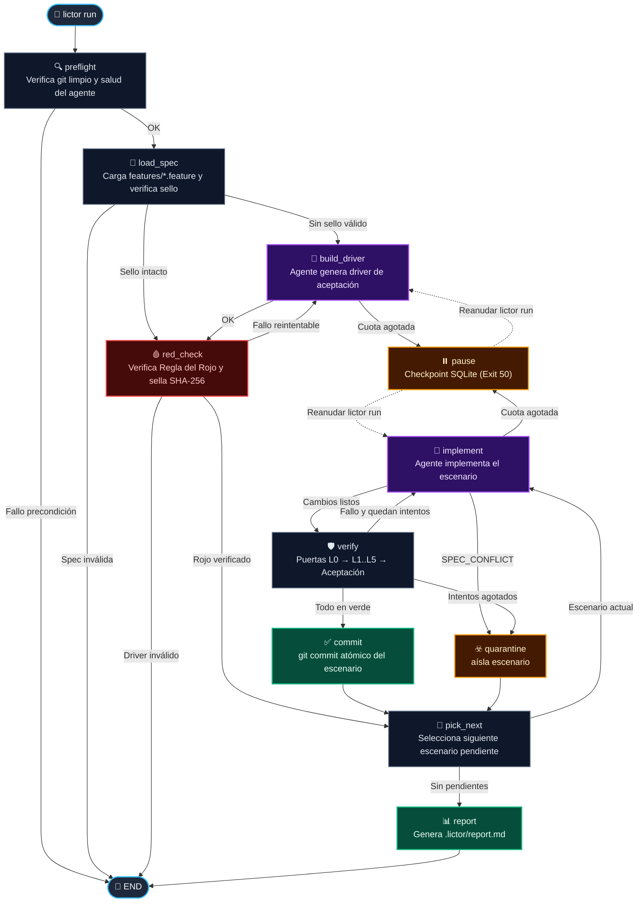
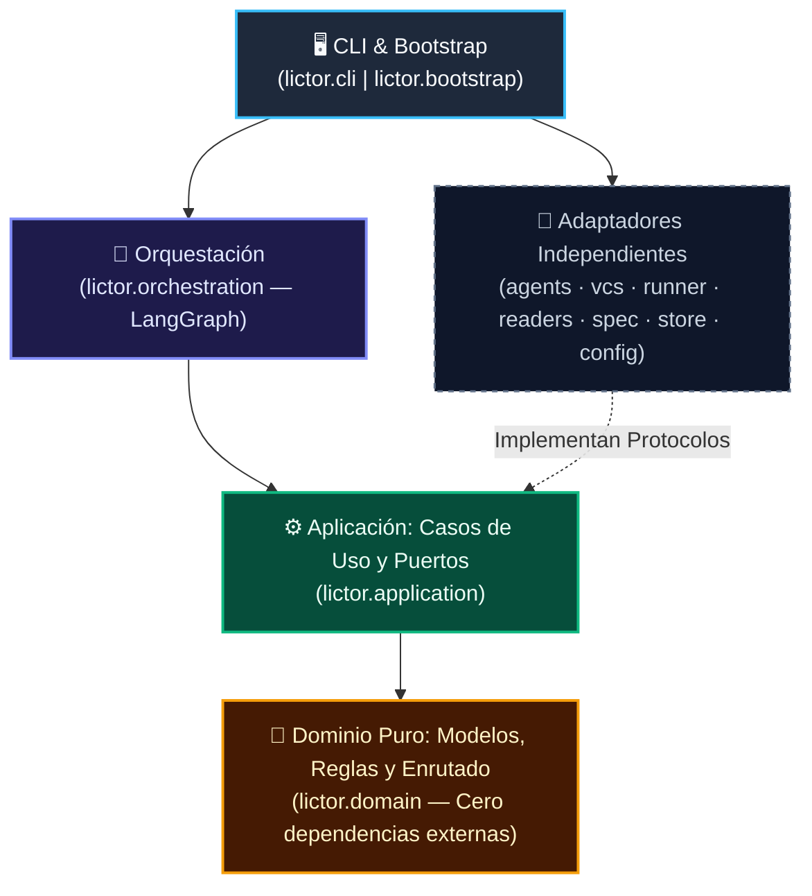

<div align="center">


<br/>


[](https://www.python.org/)
[](https://docs.astral.sh/uv/)
[](https://langchain-ai.github.io/langgraph/)
[](https://docs.astral.sh/ruff/)
[](https://mypy-lang.org/)
[](https://github.com/jmorenobl/lictor/blob/master/docs/adr/ADR-0002-arquitectura-hexagonal.md)

<p align="center">
  <strong>Implementa escenarios Gherkin con un agente autónomo y los verifica de forma 100 % determinista.</strong><br/>
  <sub>Ciclo TDD Rojo → Verde · Sellado criptográfico SHA-256 · Puertas de calidad L0–L5 · Auditoría CloudEvents 1.0</sub>
</p>

<p align="center">
  <a href="#-por-qué-lictor">¿Por qué Lictor?</a> •
  <a href="#-ciclo-de-ejecución">Ciclo de Ejecución</a> •
  <a href="#-guía-de-inicio-rápido">Inicio Rápido</a> •
  <a href="#️-referencia-de-la-cli">CLI y Códigos</a> •
  <a href="#️-puertas-de-calidad-l0l5">Puertas L0–L5</a> •
  <a href="#️-arquitectura-del-proyecto">Arquitectura</a>
</p>

</div>

---

> **🏛️ ¿Por qué el nombre *Lictor*?**
> En la antigua Roma, los *lictores* escoltaban a los magistrados portando las *fasces*: un haz de varas atadas que simbolizaba el orden, la disciplina y la ejecución determinista de la ley. **Lictor** actúa como el escolta determinista de los agentes de IA: les permite escribir código con autonomía, pero los somete estrictamente a la ley de tu especificación y de tus puertas de calidad.

---

> [!WARNING]
> **El verde todavía no resiste a un agente adversario.** Hoy significa que ese commit exacto pasó los controles y la aceptación en un clon limpio, con un entorno comprobado por hash y sin configuración de usuario. El agente trabaja en una copia sin `.git` ni `.lictor/`, pero corre con tus permisos, así que por ruta absoluta sigue alcanzando `.git`, `.lictor/`, el entorno de verificación y `~/.netrc`. Esas escrituras se detectan y se deshacen mientras Lictor está vivo, y tras una muerte impiden reanudar, salvo que se reescriba también el checkpoint. Dos limitaciones de la v0.1 no las cierra ninguna fase de este plan: cualquier código del proyecto que se importe durante los tests corre en el mismo proceso que el runner, así que puede alterar el runner o forjar el informe de aceptación (basta con que `src/` registre un plugin al importarse); y un proceso que el agente deje vivo puede plantar en el entorno entre `prepare` y su hash, que entonces lo da por bueno. Se cerrarán con el sandbox del incremento 4. Hasta entonces el verde no resiste a un adversario, y `forbidden_paths` y `banned_patterns` son heurísticas: encarecen la trampa, no la impiden.
>
> Lo que sí está cerrado son vías concretas de carga antes de los tests: `src/` no entra en el arranque de Python, de modo que un `sitecustomize.py` no se ejecuta ni en `mypy` ni en `pytest`; un paquete en `src/` no sustituye a una dependencia, porque `src` va al final de la ruta; y las variables heredadas que cargan código (`PYTHONPATH`, `PYTHONSTARTUP`, `PYTEST_ADDOPTS` y similares) se limpian.

## ⚡ ¿Por qué Lictor?

Dejar a un agente de codificación suelto sobre un repositorio suele derivar en atajos indeseados. **Lictor** invierte el control: el agente propone el código, pero **un arnés inmutable decide qué entra al repositorio**.

| Problema habitual con agentes autónomos ❌ | Cómo lo gobierna Lictor 🛡️ |
| :--- | :--- |
| **Modifican los tests** para forzar que pasen en lugar de arreglar el código. | **Sellado SHA-256 (`L0-sello`):** las features Gherkin y el *driver* de aceptación quedan sellados en `.lictor/seal.json`. Cualquier alteración aborta o revierte el intento. |
| **Escriben tests que ya pasaban** sin probar realmente la nueva funcionalidad. | **Regla del Rojo (`red_check`):** antes de implementar un escenario pendiente, su test de aceptación está obligado a **fallar en rojo**. |
| **Silencian errores** añadiendo `# noqa`, `# type: ignore` o `# pragma: no cover`. | **Escáner de supresiones (`L0-supresiones`):** inspecciona cada línea añadida en el diff y rechaza el intento si detecta directivas prohibidas. |
| **Tocan archivos prohibidos** (`pyproject.toml`, configuración o estado interno). | **Fronteras de rutas (`L0-rutas` y `L0-estado`):** revierte automáticamente archivos fuera de `paths.writable` y protege `.lictor/` con instantáneas en memoria. |
| **Dejan el verde en ficheros que nadie versiona** (`.pyc` forjados, ficheros ignorados, plugins). | **Commit candidato en clon limpio:** los controles y la aceptación corren sobre lo que se va a commitear, con un entorno comprobado por hash. |
| **Rompen escenarios anteriores** al intentar arreglar el escenario actual. | **Verificación de no regresión (`L3`):** exige que pase el escenario actual **y** todos los escenarios que ya estaban en verde. |
| **Se quedan a medias** si se agota la cuota de suscripción o API. | **Checkpoints SQLite + Pausa limpia (`exit 50`):** guarda el estado exacto del grafo LangGraph y reanuda donde quedó al volver a ejecutar `lictor run`. |

---

## 🏭 ¿Qué es una factoría agéntica de software?

Una factoría agéntica de software (*AI Software Factory*) lleva el desarrollo a una cadena de producción: entra trabajo por un lado, sale por el otro, y cada paso es repetible y auditable. Combina pasos de código deterministas, pasos de agente y, cuando hace falta, aprobación humana.

Lictor aplica esa idea a un tramo concreto, de los escenarios Gherkin al commit verificado: los agentes escriben el *driver* y la implementación, y el arnés determinista decide qué entra. Cada paso deja rastro en `.lictor/journal.jsonl` y `.lictor/runs/`. Hoy no hay aprobación humana dentro del grafo: tú escribes la especificación y resuelves las cuarentenas.

Para profundizar en el concepto:

- 🎬 [**Programar con agentes ya no basta: monta tu Software Factory**](https://youtu.be/p6nnqerea7w), de Eric Risco (17 min). Qué es una AI Factory y cómo se monta una de principio a fin.
- 🎙️ [**AI Factory: el siguiente nivel de programar con agentes**](https://youtu.be/eYbDSOkXsdM?t=119), de Codemancers (del 01:59 al 14:17). Conversación sobre las *dark factories* y los límites de los revisores automáticos. El resto del episodio trata de otros temas.

---

## ✨ Características Principales

- 🔴🟢 **Ciclo Rojo → Verde Determinista:** Generación asistida del *driver* de aceptación (`pytest-bdd`), comprobación automática de la regla del rojo y sellado criptográfico en `.lictor/seal.json`. Un rojo solo vale si cada test ejecuta su escenario y falla por una aserción o por la interfaz sin implementar, y si deja de pasar cuando la interfaz devuelve una constante.
- 🛡️ **Defensa en Profundidad (`L0`–`L5`):** Tubería secuencial desde integridad del arnés (`L0`), análisis estático y tipos estrictos (`L1`), tests unitarios (`L2`), aceptación sin regresiones (`L3`), arquitectura y seguridad (`L4`), hasta pruebas de mutación (`L5`).
- 🧬 **Aislamiento, Commits Atómicos y Cuarentena:** Cada escenario verificado produce un `git commit` limpio. Si un escenario agota sus intentos o el agente declara conflicto de especificación (`LICTOR: SPEC_CONFLICT`), Lictor pone el escenario en **cuarentena** y continúa con el resto. No hay nada que deshacer: el agente trabaja en una copia y la rama solo avanza con lo verificado.
- 📊 **Trazabilidad CloudEvents 1.0 e Informes Ejecutivos:** Bitácora append-only en `.lictor/journal.jsonl` y generación automática de `.lictor/report.md` con métricas de tokens, coste en USD, duración de agente vs. verificación y commits por escenario.
- 🏛️ **Arquitectura Hexagonal Pura:** Dominio 100 % libre de frameworks (`langgraph`, `pydantic`, `typer` prohibidos en el núcleo), blindado con contratos de `import-linter`.

---

## 🔄 Ciclo de Ejecución

El motor de orquestación ejecuta un grafo de estados de **11 nodos** con persistencia transaccional en SQLite (`PRAGMA synchronous = FULL`):



---

## 📦 Requisitos e Instalación

### Requisitos Previos

- **Sistema operativo:** Linux o macOS. **Windows no está soportado:** el entorno de verificación, los grupos de procesos y las rutas del perfil son POSIX.
- **Python** `>= 3.12`
- **[uv](https://docs.astral.sh/uv/)** (gestor de paquetes y entornos de Astral)
- **Git** instalado y disponible en `PATH`
- **[Claude Code CLI](https://docs.anthropic.com/en/docs/agents-and-tools/claude-code/overview)** (`claude`) autenticado *(para el backend por defecto `claude-cli`)*

### Instalación

Lictor está en [PyPI](https://pypi.org/p/lictor). Instálalo como herramienta, fuera del proyecto en el que lo uses:

```bash
uv tool install lictor      # o: pipx install lictor
lictor --version
```

También puedes probarlo sin instalarlo con `uvx lictor --version`.

Para trabajar en el propio Lictor:

```bash
git clone https://github.com/jmorenobl/lictor.git
cd lictor
uv sync --all-groups
uv run lictor --help
```

Esa copia es editable, y con el venv del repositorio activado puede ir delante de la instalada en el `PATH`. `lictor --version` lo dice: `lictor 0.2.0 (editable, desde /ruta/al/repositorio)`. Una instalación desde PyPI dice solo la versión.

---

## 🚀 Guía de Inicio Rápido

### 0️⃣ Crea el proyecto

Lictor trabaja sobre un proyecto `uv` con su `uv.lock` y un repositorio git. Para empezar de cero:

```bash
uv init --lib calculadora && cd calculadora   # ya crea el repositorio git
git branch -m main                            # solo si quieres otro nombre para la rama
uv add --dev pytest pytest-bdd ruff mypy      # las herramientas que usan los controles del perfil
```

`uv init` ya inicializa el repositorio, con tu rama por defecto: un `git init -b main` después no hace nada y solo avisa. A Lictor le da igual cómo se llame la rama.

`uv init --lib` deja un paquete en `src/`. El driver crea ahí la interfaz que necesiten sus pasos, sin lógica, y el agente la implementa escenario a escenario. Todas las dependencias, también las de desarrollo, van antes de la primera ejecución: el agente no puede tocar `pyproject.toml` ni `uv.lock`. Si quieres medir cobertura, añade también `pytest-cov`.

### 1️⃣ Escribe tus escenarios Gherkin en `features/`

Cada escenario debe ir etiquetado con un identificador único `@<PREFIJO>-<NÚMERO>` (por ejemplo, `@IVA-001`):

```gherkin
# features/iva.feature
# language: es
Característica: IVA de una factura

  @IVA-001
  Escenario: IVA general
    Dado una factura con importe 100
    Cuando calculo el IVA general
    Entonces el total es 121

  @IVA-002
  Escenario: IVA reducido
    Dado una factura con importe 100
    Cuando calculo el IVA reducido
    Entonces el total es 110

  @IVA-003
  Escenario: Importe negativo
    Dado una factura con importe -5
    Cuando calculo el IVA general
    Entonces se rechaza por importe no válido
```

> 💡 *Puedes explorar este proyecto de ejemplo directamente en el directorio [`examples/demo-iva/`](https://github.com/jmorenobl/lictor/tree/master/examples/demo-iva).*

### 2️⃣ Inicializa y diagnostica el proyecto

```bash
# Detecta automáticamente el perfil (ej. python-uv@0.1) y crea lictor.json
lictor init
```

```text
Configuración inicializada en 'lictor.json':
  Perfil: python-uv@0.1
  Modelo: claude-sonnet-5-5 (backend.model; otro con --model)
  hints: «Python >=3.14, gestor uv, tests con pytest. El código va en src/<paquete>/.»
    Lo lee el agente en cada llamada: ajústalo a tu proyecto.
  .gitignore: añadidas .lictor/, __pycache__/, *.pyc, .venv/, .pytest_cache/, .mypy_cache/, .ruff_cache/
  Skill de Lictor para Claude Code: .claude/skills/lictor/SKILL.md
Siguiente paso: haz commit de estos cambios y ejecuta `lictor doctor`.
```

La versión de Python de `hints` sale del `requires-python` de `pyproject.toml`. Revisa `hints` antes del commit (ver «Qué va en `hints`», más abajo).

```bash
git add -A && git commit -m "chore: proyecto inicial"   # Lictor parte de un árbol limpio

# Comprueba lo mismo que `lictor run` antes de llamar al agente, entorno de verificación incluido
lictor doctor
```

```text
✓ Configuración válida: perfil 'python-uv@0.1'
✓ Árbol git limpio
✓ Identidad git
✓ Ejecutor
✓ Directorio temporal
✓ Comandos de verificación
✓ Entorno de verificación
Doctor: todas las comprobaciones pasaron.
```

`doctor` construye de verdad el entorno de verificación, en un directorio desechable, sin tocar el de una ejecución. Si hay una ejecución en curso, comprueba todo lo demás y deja el entorno como «no comprobado».

### 📝 Qué va en `hints`

`hints` es texto libre de `lictor.json` que reciben el driver y el implementador en cada llamada. Sirve para la **interfaz**: lo que el agente necesita saber del proyecto y que no está en el Gherkin. Por ejemplo, dónde vive el código, el nombre y la firma de la función que prueban los tests, cómo se prueba una CLI o qué módulo fija `[project.scripts]`.

No sirve para reglas de **comportamiento**. Nada comprueba `hints`: si una regla importa, escríbela como escenario. En la pasada de prueba, `hints` decía que `main` nunca termina el proceso, ningún escenario lo cubría, y `--help` lo terminaba igual.

Las instrucciones de cómo escribir el driver (`acceptance.driver_hints`) son del perfil y se leen de él en cada carga, así que sus mejoras llegan a todos los proyectos. Un `lictor.json` no puede declararlas: Lictor lo rechaza al cargar. Lo propio del proyecto va en `hints`.

### 💻 Probar una CLI

El proyecto no se instala en el entorno de verificación, así que el ejecutable de una CLI no existe allí. Los tests la prueban dentro del proceso:

- **Una función de entrada con `argv`.** Por ejemplo, `romanos.cli:main(argv: list[str]) -> int`. Los tests la llaman y leen la salida con `capsys`; nunca lanzan `romanos …`.
- **Decide antes si `main` devuelve el código de salida o termina el proceso.** `argparse` termina con `SystemExit` en `--help` y en sus propios errores, con mensajes en inglés. Si eso importa, escríbelo como escenario.
- **Lo que fija `pyproject.toml` va antes del run.** El agente no puede tocarlo, así que el `[project.scripts]` lo añades tú. El módulo y la función que nombres ahí van en `hints`, para que el driver los respete.

Un `hints` para una CLI:

```text
Python >=3.14, gestor uv, tests con pytest. El código va en src/romanos/. La CLI es
romanos.cli:main(argv: list[str]) -> int, declarada en [project.scripts]; los tests la llaman en
el proceso y leen stdout y stderr con capsys; el proyecto no está instalado, así que no se lanza
el ejecutable.
```

### 🤝 La skill de Lictor para Claude Code

`lictor init` instala en `.claude/skills/lictor/SKILL.md` una skill que ayuda a preparar el proyecto, a redactar los escenarios contigo y a leer los resultados. Nunca escribe tests ni código, ni lanza `lictor run`, ni hace commits: los escenarios los decides tú, y te pregunta por los casos que el contrato deja abiertos.

El fichero es solo un esbozo: al cargarse, Claude Code ejecuta `lictor skill --show`, que imprime la skill de la versión instalada, así que al actualizar Lictor la skill se actualiza sola. Commitéalo para que lo tenga todo el equipo: el agente de Lictor no lo carga. Si el esbozo no es el de tu versión, `lictor doctor` lo avisa y `lictor skill` lo restaura. Si no la quieres, usa `lictor init --no-skill`.

### 3️⃣ Ejecuta el ciclo autónomo y consulta el informe

```bash
# Implementa y verifica todos los escenarios de forma determinista
lictor run

# Consulta el estado actual de la ejecución, también desde otra terminal mientras trabaja
lictor status

# Regenera y muestra la ruta del informe en Markdown (.lictor/report.md)
lictor report
```

Mientras trabaja, `lictor run` cuenta cada paso en stderr, y stdout queda para el resultado. Con `--quiet` no cuenta nada:

```text
Entorno de verificación listo.
Escenarios: 3 (0 en verde, 3 pendientes).
driver: escribiendo el driver, intento 1 de 2…
driver: sellado (1 llamada, 0,07 $).
IVA-001: implementando, intento 1 de 3…
IVA-001: verde, intento 1, 28 s, 0,03 $.
IVA-002: implementando, intento 1 de 3…
IVA-002: verde, intento 1, 27 s, 0,02 $.
IVA-003: implementando, intento 1 de 3…
IVA-003: verde, intento 1, 31 s, 0,02 $.
Total: 4 llamadas, 0,14 $; 3 en verde, 0 en cuarentena, 0 pendientes.
```

`lictor status` dice en qué escenario e intento está, cuántos verdes lleva y cómo llegaron (implementados, colaterales, de antes), y las llamadas y el coste acumulados.

<details>
<summary>📄 <strong>Ver ejemplo de informe generado en <code>.lictor/report.md</code></strong></summary>

```markdown
# Informe de ejecución de Lictor

## Resumen
- **Ejecución**: 20261110-101500-3f9c
- **Escenarios en verde**: 3
- **Escenarios en cuarentena**: 0
- **Escenarios pendientes**: 0
- **Código de salida**: 0
- **Motivo**: Ejecución completada: 3 escenarios en verde
- **Llamadas al agente**: 4 (driver: 1)
- **Coste total**: 0,1406 $
- **Duración total**: 2 min 31 s (agente 1 min 58 s, verificación 9 s)

## Escenarios
| ID | Nombre | Estado | Intentos | Llamadas | Tokens (entrada / salida) | Coste | Tiempo agente | Tiempo verificación | Commit |
|---|---|---|---|---|---|---|---|---|---|
| driver | Driver de aceptación | sellado | 1 | 1 | 61204 / 2310 | 0,0710 $ | 41 s | - | 3f9c2a7b1d04 |
| IVA-001 | IVA general | verde | 1 | 1 | 41120 / 890 | 0,0257 $ | 25 s | 3 s | a1b2c3d4e5f6 |
| IVA-002 | IVA reducido | verde | 1 | 1 | 38850 / 640 | 0,0212 $ | 24 s | 3 s | 0e4f5a6b7c8d |
| IVA-003 | Importe negativo | verde | 1 | 1 | 40010 / 710 | 0,0227 $ | 28 s | 3 s | 9a7b8c6d5e4f |
| **Total** | | | | 4 | 181184 / 4550 | 0,1406 $ | 1 min 58 s | 9 s | |

*La entrada incluye la caché: los tokens leídos y escritos en ella, que son casi toda la entrada de un agente.*

## Cuarentenas
- *Ningún escenario en cuarentena.*

## Intentos fallidos por nivel
- *Sin fallos registrados.*

## Verificaciones
| Escenario | Intento | Resultado | Error |
|---|---|---|---|
| IVA-001 | 1 | verde | - |
| IVA-002 | 1 | verde | - |
| IVA-003 | 1 | verde | - |

## Controles en medición
- *Ningún control en medición.*

## Puntuaciones
- *Ningún control registró puntuación.*

## Drivers rechazados
- *Ningún driver rechazado.*
```

</details>

---

## 🛠️ Referencia de la CLI

### Comandos Disponibles

| Comando | Opciones | Descripción |
| :--- | :--- | :--- |
| `lictor init` | `--profile, -p <nombre>`<br/>`--model, -m <id>`<br/>`--force, -f`<br/>`--no-skill` | Inicializa `lictor.json` en el repositorio detectando el perfil del proyecto (o aplicando el indicado), actualiza `.gitignore` e instala el esbozo de la skill de Lictor para Claude Code (salvo con `--no-skill`). |
| `lictor skill` | `--show` | Instala o restaura el esbozo de la skill en `.claude/skills/lictor/SKILL.md`, sin tocar `lictor.json`. Con `--show` imprime la skill completa de la versión instalada, sin escribir nada. |
| `lictor doctor` | — | Comprueba, sin llamar al agente, lo mismo que `lictor run` al empezar: `lictor.json`, árbol `git` limpio, identidad git, ejecutor, directorio temporal privado, que existen los programas de los controles y de la aceptación, y que `verification.prepare` construye el entorno. Lo informa todo, sin parar en el primer fallo. |
| `lictor check` | `--level, -l <niveles>`<br/>`--control, -c <id>` (repetible)<br/>`--keep-going` | Verifica como `lictor run`: los controles y la aceptación (`--control acceptance`) en un clon limpio y en el entorno de verificación. Lo que está sin confirmar se verifica como el commit que resultaría de confirmarlo, fuera de la rama. Para en el primer fallo bloqueante salvo con `--keep-going`. Deja la evidencia en `.lictor/check/`. |
| `lictor register` | `<ID>...`<br/>`--yes` | Registra en verde escenarios que el código ya cumple, como afirmación tuya (ver «Adoptar Lictor en un proyecto existente»). Explica lo que afirmas y pide confirmación. |
| `lictor run` | `--new`<br/>`--quiet, -q` | Ejecuta o reanuda el grafo determinista desde el último checkpoint para implementar y verificar todos los escenarios. Cuenta cada paso en stderr salvo con `--quiet`. |
| `lictor status` | `--json` | Muestra el estado de la ejecución actual a partir del checkpoint SQLite y la bitácora de eventos: escenario e intento en curso, verdes implementados y colaterales, llamadas y coste. Se puede lanzar durante una ejecución. |
| `lictor report` | `--run <run_id>` | Regenera el informe `.lictor/report.md` a partir de `.lictor/journal.jsonl`, deja una copia en `.lictor/runs/<run_id>/report.md` y muestra su ruta. |

### Códigos de Salida Estables

Diseñados para integrarse de forma predecible en pipelines de CI/CD y scripts de automatización. Cada salida explica su motivo en stderr, en `.lictor/journal.jsonl` y en `.lictor/report.md`:

| Código | Constante (`ExitCode`) | Significado |
| :---: | :--- | :--- |
| **`0`** | `OK` | Todos los escenarios (o controles en `lictor check`) pasaron en verde. |
| **`1`** | `INTERNAL_ERROR` | Error interno inesperado del runtime. |
| **`10`** | `PRECONDITION` | Hay que cambiar algo del proyecto: árbol `git` sucio, configuración inválida o un comando vacío, spec/driver inválido o sello alterado (`SealTamperedError`). En `lictor check`, un control bloqueante que falla. |
| **`11`** | `SPEC_CONFLICT` | Al menos un escenario entró en cuarentena porque el agente declaró contradicción o imposibilidad (`LICTOR: SPEC_CONFLICT`). |
| **`30`** | `QUARANTINED` | Al menos un escenario quedó en cuarentena tras agotar `max_attempts`. Si todos sus intentos fallaron por un error del propio driver, el motivo es `driver_sospechoso`. |
| **`40`** | `ENVIRONMENT_UNAVAILABLE` | No se pudo ejecutar por el entorno, al arrancar o a mitad de ejecución: el agente no tiene sesión o no responde, git no tiene identidad para los commits, falta un programa de los controles o de la aceptación, el directorio temporal no es privado, o no se pudo preparar el entorno de verificación. No es un fallo del trabajo y no penaliza escenarios: no gasta intentos ni pone nada en cuarentena. Arregla el entorno y relanza `lictor run`; `lictor doctor` dice qué falla. |
| **`50`** | `RATE_LIMITED` | Ejecución pausada en checkpoint por límite de cuota de la suscripción/API. Reanudable ejecutando `lictor run`. |

---

## 🛡️ Puertas de Calidad (`L0`–`L5`)

Las puertas L0 miran el árbol del agente. Los controles y la aceptación corren en un **clon limpio de un commit candidato**, fuera de la rama, y la rama avanza a ese SHA exacto solo si pasan: lo verificado es lo commiteado.

Cada intento del agente atraviesa una tubería de verificación secuencial que **corta en el primer fallo bloqueante** y condensa el error para alimentar el siguiente intento. El mensaje queda acotado por `limits.error_max_chars` y siempre conserva el motivo; el error completo va a `.lictor/runs/`. Los controles `measure` no bloquean, pero su resultado y su salida quedan registrados en `.lictor/journal.jsonl` y `.lictor/report.md`:

| Nivel | Puerta | Qué verifica | Modo |
| :---: | :--- | :--- | :---: |
| **L0** | `L0-sin-cambios` | Un intento cuyo árbol es igual a HEAD falla antes de ejecutar nada. | `block` |
| **L0** | `L0-rutas` | El agente solo puede modificar `paths.writable`. Cualquier cambio en rutas protegidas o en `forbidden_paths`, un borrado incluido, y cualquier enlace simbólico o repositorio anidado, falla el intento; lo que hizo el agente se descarta con su copia. | `block` |
| **L0** | `L0-sello` | Comprueba que ningún archivo en `features/` ni en `paths.driver` haya cambiado respecto a los hashes `SHA-256` de `.lictor/seal.json`. | `block` |
| **L0** | `L0-supresiones` | Analiza las líneas que añade el resultado del agente, también en binarios, bloqueando `suppressions` y las expresiones de `banned_patterns`, sin distinguir mayúsculas: `# noqa`, `#type:ignore`, `# ruff: noqa`, `pytest.skip(`… | `block` |
| **L0** | `L0-estado` | Guarda en memoria el estado de `.lictor/` (con el WAL del checkpoint), `lictor.json`, HEAD y los ficheros de control de `.git` antes de cada ventana del agente y cada comando. Si algo cambió, lo restaura y falla el intento sin verificarlo, con el evento `lictor.state.tampered.v1` ([ADR-0001](https://github.com/jmorenobl/lictor/blob/master/docs/adr/ADR-0001-estado-en-dot-lictor.md)). | `block` |
| **L0** | `L0-entorno` | Compara el hash del entorno de verificación, con todos sus ficheros, antes y después de ejecutar los comandos. Si no coincide, falla el intento, reconstruye el entorno y deja el evento `lictor.env.tampered.v1`. | `block` |
| **L1** | Análisis estático | Linter (`ruff check`), formato (`ruff format --check`) y chequeo estricto de tipos (`mypy --strict`). | `block` |
| **L2** | Pruebas unitarias | Ejecución rápida de tests unitarios aislados (`pytest tests/unit`) con lectura de JUnit XML. | `block` |
| **L3** | Aceptación y no regresión | Enlaza cada test con el escenario de Gherkin que ejecutó (en `python-uv`, el que informa el plugin del perfil; sin él, por el `@ID-NNN` del nombre): exige que el escenario actual pase **y que ningún escenario previamente en verde haya regresionado**. Los pendientes que el mismo árbol también hace pasar se registran como verdes colaterales sin llamar al agente. | `block` |
| **L4** | Arquitectura, cobertura y seguridad | Contratos de capas (`lint-imports`), cobertura de ramas (`>= 90 %` global, `>= 95 %` dominio), vulnerabilidades (`pip-audit`) y secretos (`gitleaks`). | `block` |
| **L5** | Mutación | Pruebas de mutación (`mutmut`) sobre el dominio y los módulos pequeños de la aplicación para medir la fortaleza real de la suite unitaria. En GitHub Actions corre con `schedule` y `workflow_dispatch`, no en cada cambio. Registra resultado, salida y puntuación: `scripts/mutation_score.py` deja los recuentos donde los lee el lector `mutation` (si la exportación falla, no deja informe y el control falla), y el informe muestra, en «Puntuaciones» sea cual sea el modo, por ejemplo, «96,1 % (1585 de 1649 muertos; 64 vivos, 0 por tiempo)», y deja la lista de supervivientes en `mutation-survivors.txt`. Con `min_score` el control falla por debajo de ese porcentaje: el de Lictor exige un 95 %. | `block` (con `min_score`) o `measure` |

---

## ⚙️ Configuración (`lictor.json`)

El archivo `lictor.json` define el perfil del proyecto, el backend del agente, los límites de intentos, las fronteras de rutas y los controles. Puedes consultar su esquema formal en [`schema/lictor.schema.json`](https://github.com/jmorenobl/lictor/blob/master/schema/lictor.schema.json).

> [!IMPORTANT]
> - **ID de modelo explícito:** `backend.model` exige el identificador completo con versión (p. ej. `claude-sonnet-5-5`) y rechaza alias mutables como `sonnet` o `latest`.
> - **Fronteras disjuntas:** `paths.writable` nunca puede solaparse con `paths.protected` ni con `paths.driver`.
> - **Marcador JUnit:** Todo control o suite de aceptación con `"report": "junit"` debe incluir `{out}` en su comando `run`.

<details>
<summary>⚙️ <strong>Ver ejemplo completo de <code>lictor.json</code> y estructura de <code>.lictor/</code></strong></summary>

### Ejemplo de `lictor.json`

```json
{
  "version": "0.1",
  "profile": "python-uv@0.1",
  "backend": {
    "kind": "claude-cli",
    "model": "claude-sonnet-5-5",
    "auth": "subscription",
    "max_turns": 40,
    "timeout_s": 1800
  },
  "limits": {
    "max_attempts": 3,
    "max_driver_attempts": 2,
    "error_max_chars": 4000
  },
  "paths": {
    "writable": ["src/", "tests/unit/"],
    "driver": ["tests/acceptance/"],
    "protected": ["features/", "tests/acceptance/", "lictor.json", "pyproject.toml", "uv.lock"]
  },
  "acceptance": {
    "run": "uv run pytest tests/acceptance -q --junitxml {out}",
    "failure_exit_codes": [1],
    "report": "junit",
    "timeout_s": 600
  },
  "controls": [
    {"id": "lint",  "level": "L1", "run": "uv run ruff check src", "report": "exit-code", "mode": "block"},
    {"id": "types", "level": "L1", "run": "uv run mypy src", "report": "exit-code", "mode": "block"},
    {"id": "unit",  "level": "L2", "run": "uv run pytest tests/unit -q --junitxml {out}", "report": "junit", "mode": "block", "empty_exit_codes": [5], "when_exists": "tests/unit"},
    {"id": "coverage", "level": "L2", "run": "uv run pytest tests/unit -q --cov=src --cov-branch --cov-report=term", "report": "exit-code", "mode": "measure", "empty_exit_codes": [5], "when_exists": "tests/unit", "when_plugin": "pytest_cov.plugin"}
  ],
  "verification": {"env": {}, "inherit": [], "prepare_inherit": []},
  "agent_tools": ["Bash(uv run pytest:*)", "Bash(uv run ruff:*)", "Bash(uv run mypy:*)"],
  "agent_commands": ["uv run ruff check src", "uv run mypy src", "uv run pytest tests/unit -q", "uv run pytest tests/acceptance -q"]
}
```

**Qué manda cada lado.** Lo que garantiza la verificación lo declara solo el perfil y se lee de él en cada carga: un `lictor.json` no lo contiene, así que no puede quedar obsoleto. Declarar en `lictor.json` cualquiera de estos campos es un error de configuración.

| Lado | Campos | Regla |
| :--- | :--- | :--- |
| Perfil | `verification.prepare`, `prepare_inherit`, `prepare_ask`, `prepare_home_files`, `env`, `inherit`, `reserved`, `plugin_variable`, `plugins`, `plugins_command`, `files_dir_command`, `files`; `suppressions`, `banned_patterns`, `forbidden_paths`; `oracle`; `acceptance.driver_hints` | Ningún proyecto los cambia ni los quita |
| Proyecto | `verification.env`, `verification.inherit`, `verification.prepare_inherit` | Solo añaden. Tocar una variable que el perfil fija, hereda o reserva da exit 10 |
| Proyecto | `paths`, `acceptance`, `controls`, `agent_tools`, `agent_commands`, `hints`, `gitignore` | Sustituyen al valor del perfil, que `lictor init` escribe como punto de partida |

El entorno de los comandos parte de vacío: `inherit` lista los nombres exactos que pasan y `env` fija después lo que debe valer, así que `env` gana y lo que nadie enumeró no entra. Cada comando tiene además un `HOME` vacío y nuevo, fuera del proyecto, así que tu configuración de usuario (`~/.config/ruff`, `~/.config/mypy`, `~/.config/uv`) no decide ningún control. Pytest corre sin autoload de plugins, y aun así un proyecto no declara ninguno: al construir el entorno, antes de calcular su hash, Lictor pregunta a su intérprete en modo aislado (`plugins_command`) qué plugins tiene instalados y los fija en `plugin_variable`, junto con los del perfil. La lista va a `.lictor/verify_env.json` y se compara en cada comprobación; lo que aparezca después no se carga y falla `L0-entorno`. Un plugin debe publicarse como módulo: uno con la forma `modulo:objeto` no se puede cargar por nombre y da exit 40. Como los plugins se registran por módulo, `-p no:<nombre>` en `addopts` no siempre los bloquea en la verificación: solo si el módulo se llama `<nombre>` o `pytest_<nombre>`. `files` son ficheros `.py` que acompañan al perfil y Lictor copia en el entorno antes de calcular su hash, en el directorio que imprime `files_dir_command`, que pregunta al intérprete del entorno.

**`prepare` tiene su propio entorno.** La red y las credenciales pasan por `prepare_inherit`, que los comandos no ven. También usa un `HOME` vacío: el intérprete se pregunta a `uv` (`prepare_ask`) y `~/.netrc` se le indica por `NETRC` (`prepare_home_files`). Usa `--no-cache`, porque una entrada envenenada de la caché compartida de `uv` llegaba al entorno y el hash la daba por buena. A cambio, cada construcción descarga contra los hashes de `uv.lock`, una vez por ejecución: sin red, exit 40. Un proyecto que necesite otra variable en `prepare`, como `PYENV_ROOT`, la declara en `verification.prepare_inherit`.

**Tu árbol de trabajo es tuyo.** El agente no trabaja en él, y Lictor solo lo toca al guardar un commit verde, con un *fast-forward*: tus ediciones sobreviven y, si un commit pisaría una, se para con exit 10 sin perder nada. `lictor run` lo reanuda cuando lo resuelvas, sin repetir el trabajo verificado. El agente recibe una copia de HEAD sin ficheros ignorados, así que no ve un `.env` ni datos locales; tampoco los verá la verificación.

**Reanudar comprueba qué pasó mientras tanto.** `lictor run` compara el hash de `lictor.json` combinado con su perfil, incluido el contenido de `files`, y el HEAD, el `seal.json` y los ficheros de control de `.git` que registró la ejecución. También rechaza reanudar con cambios sin confirmar, sin tocarlos. En todos los casos sale con exit 10 y dice qué hacer. Un cambio solo de formato en `lictor.json` no cuenta. La única excepción al HEAD registrado es el commit vacío con el que el rojo registra verdes sin agente, si la ejecución murió justo después: se acepta solo con el rojo pendiente, sobre la cabeza registrada y con su mismo árbol, y el rojo repetido vuelve a probar cada verde.

**Un control puede depender de una ruta.** Con `when_exists`, el control solo se omite si esa ruta no existe ni en HEAD ni en el intento, y queda `omitido`, con el motivo, en `verify.finished` y en `report.md`. Si existía y el intento la elimina, el control falla. `lictor check` aplica la misma regla a lo que verifica. Así un proyecto sin `tests/unit` no bloquea al agente.

**Un control puede depender de un plugin.** Con `when_plugin`, el control se omite, con el motivo, si el entorno de verificación no carga ese plugin. La lista sale de lo que Lictor pregunta al entorno al construirlo (`plugins_command`). Si el perfil no puede preguntarlo, el control se ejecuta. Así funciona el control `coverage` de `python-uv`: mide la cobertura de `src` con los tests unitarios en modo `measure`, sin bloquear, y solo si el proyecto tiene `pytest-cov`, que tiene que añadir una persona (`uv add --dev pytest-cov`) porque el agente no puede tocar `uv.lock`. Sin él, cada ejecución lo muestra como omitido, no como fallido. El porcentaje queda en la salida del control, en `.lictor/runs/`.

### El oráculo y el ciclo de escenarios

El driver sellado es el oráculo: lo que decide si un escenario está en verde. El perfil declara qué lo hace válido en su bloque `oracle`, que ningún `lictor.json` toca.

- **Enlace con el escenario (`link: "scenario"`).** Cada test de escenario tiene que ejecutar su escenario de Gherkin (`@scenario` de `pytest-bdd`) desde el `.feature` donde está ese escenario, no desde una copia. Un test que lleva el id en el nombre sin ejecutarlo, o que ejecuta otro, rechaza el driver, y también un driver nuevo con tests que no son de ningún escenario.
- **Rojo válido (`red_kinds`).** Un pendiente falla por una aserción o por `NotImplementedError` lanzado desde `paths.writable`, fuera del driver. Un error del propio test se rechaza. El plugin `lictor_outcome` del perfil informa la clase y el origen de cada fallo como propiedades del JUnit, por la clase de la excepción y nunca por el texto.
- **Impostores (`impostors`).** Antes de sellar un driver nuevo, Lictor repite la aceptación en clones donde cada `raise NotImplementedError` de una línea se sustituye por `return None` y por `return True`. Cada escenario nuevo tiene que fallar con alguno de los dos: si pasa con ambos, su test ignora el resultado. Cualquier fallo cuenta, así que no atrapan un test sin aserción que solo lee el resultado (`calc(...).total` falla con los dos).

Un escenario está en verde mientras lo que exige no cambie: Lictor calcula una huella de sus pasos, tablas, docstrings, antecedentes y ejemplos (sin nombres, tags, comentarios, espacios ni idioma) en el árbol de su commit verde y la compara con la actual. Si difiere, el escenario se **reabre**: el driver se reconstruye con esa indicación y, si su test falla como un rojo válido, vuelve a implementarse. Si su test sigue pasando con el driver nuevo, Lictor para con exit 10 sin reintentar: el paso puede conservar el valor antiguo, y solo tú sabes si el cambio fue de redacción. Si la implementación ya cumple la nueva especificación, regístralo con `lictor register <id>` y relanza; si no, su test no detecta el cambio. Un escenario nuevo que pasa con un driver nuevo es casi siempre un test vacío: el driver se rechaza y el agente lo vuelve a intentar, y solo al agotar los intentos se para con exit 10. Un pendiente que el driver sellado ya hace pasar se registra como verde colateral (trailer `Lictor-Collateral`). Si todos los intentos de un escenario fallan con un error del propio driver, la cuarentena lo dice: posible driver defectuoso, sin asegurarlo (exit 30). No lo detecta si el driver tiene una aserción imposible de cumplir o un `pytest.fail` en un paso.

### Adoptar Lictor en un proyecto existente

Con un driver nuevo, Lictor no puede distinguir un test que pasa porque el código ya cumple el escenario de uno que no comprueba nada: por eso nunca pone en verde, por su cuenta, un escenario nuevo que ya pasa. En un proyecto que ya tiene código, registra tú, **antes de la primera ejecución**, los escenarios que el código ya cumple:

```bash
lictor register PRE-001 PRE-002 PRE-003
lictor run
```

`lictor register` comprueba que los escenarios existen y no están en verde, te explica lo que afirmas y te pide confirmación (`--yes` para no preguntar). Hace un solo commit vacío con un trailer `Scenario:` por escenario y `Lictor-Asserted-By` con tu identidad git. El driver que Lictor escriba después solo tendrá que pasar esos escenarios, como cualquier verde. `report.md` y `lictor status` los muestran como **registrados a mano**: todo verde cuyo commit no lleva `Lictor-Run`, que Lictor pone en todos los suyos. La marca es informativa: los trailers los puede escribir cualquiera con git. [`examples/prestamos-biblioteca/`](https://github.com/jmorenobl/lictor/tree/master/examples/prestamos-biblioteca) es un ejemplo con código previo, `Antecedentes` y `Regla`.

`Scenario Outline` no se admite: `lictor run` lo rechaza al cargar la especificación (exit 10). Cada escenario necesita exactamente un test, y un esquema genera uno por fila de sus ejemplos.

**`paths.protected` es decisión del proyecto.** `lictor init` escribe la lista del perfil como punto de partida, pero `paths` sustituye a ese valor, así que un `lictor.json` puede quitar entradas. `uv.lock` es la excepción: lo que el bloqueo instala es lo que entra en el entorno de verificación, y un plugin instalado se carga, así que también está en `forbidden_paths` y el agente no puede cambiarlo aunque el proyecto lo quite de esa lista. `forbidden_paths` y `IntegritySnapshot` cubren parte del resto, pero no sustituyen a `paths.protected`.

**Por qué `UV_*` está reservado.** Esas variables deciden dónde se instala el entorno, si `uv` puede sincronizarlo y de dónde baja código. Un proyecto que las fijase podría deshacer lo que el perfil garantiza, de modo que nombrar una da exit 10.

**Índice privado.** `verification.prepare` usa `--frozen`, de modo que las URL salen de `uv.lock` y solo faltan las credenciales. `UV_INDEX_<NOMBRE>_USERNAME` y `_PASSWORD` funcionan en `uv`, pero quedan fuera por lo anterior. Hay dos vías, sin ninguna contraseña en `lictor.json` ni en `uv.lock`:

- `~/.netrc`, que `prepare` recibe por `NETRC` aunque su `HOME` esté vacío.
- Un fichero netrc en otra ruta, con la variable `NETRC`.

Ambas se probaron con `uv` 0.12.18 contra un índice local con autenticación básica sobre HTTP: sin credenciales, `prepare` falla (exit 40 en Lictor) y con ellas instala. No se han probado contra un índice real ni con `keyring`. Ni la variable ni la ruta llegan a los comandos, pero el código del proyecto corre con tu usuario y puede leer `~/.netrc` si conoce la ruta: eso solo lo cierra el sandbox.

### Artefactos internos en `.lictor/` (ignorados por git)

| Ruta | Propósito |
| :--- | :--- |
| `.lictor/current_run` | Identificador de la ejecución activa para reanudación automática. |
| `.lictor/checkpoints.sqlite` | Estado transaccional del grafo LangGraph. |
| `.lictor/seal.json` | Hashes `SHA-256` de `features/*.feature` y de los archivos del *driver*. |
| `.lictor/journal.jsonl` | Bitácora inmutable de eventos en formato CloudEvents 1.0. |
| `.lictor/report.md` | Informe ejecutivo en Markdown generado al finalizar o mediante `lictor report`. Cada ejecución lo sobrescribe y deja una copia en `.lictor/runs/<run_id>/report.md`. |
| `.lictor/verify-env/` | Entorno de verificación, construido una vez por ejecución fuera del clon. |
| `.lictor/verify_env.json` | Hash esperado de ese entorno y plugins que tiene instalados. |
| `.lictor/runs/<run_id>/<escenario o driver>/` | Evidencia por intento: crudo del agente, su stderr y el prompt que recibió (`NNN-implement.json`, `NNN-implement.stderr.log`, `NNN-implement.prompt.md`) y un directorio por verificación (`NNN-verify/`, `NNN-red/`) con informes, salida de cada control y el error completo (`error.txt`). Ningún reintento pisa a otro: los nombres repetidos llevan `-rN`. Al empezar una ejecución nueva se conservan las `retention.keep_runs` más recientes (10 por defecto, contando la nueva) y nunca la de `current_run`; la bitácora registra lo retirado (`runs.pruned`) y el informe lo distingue de la evidencia alterada. |
| `.lictor/check/` | Lo que deja el último `lictor check`: informes y salida de cada control, el log del entorno y su bitácora. Cada `check` sustituye al anterior. |
| `.lictor/doctor/` | El log y la bitácora del entorno desechable del último `lictor doctor`. |

</details>

---

## 🏗️ Arquitectura del Proyecto

Lictor sigue una **Arquitectura Hexagonal (Puertos y Adaptadores)** estricta. Todas las dependencias apuntan hacia el interior y se verifican mediante [`.importlinter`](https://github.com/jmorenobl/lictor/blob/master/.importlinter):



### Estructura de Directorios

```text
├── pyproject.toml              # Configuración de paquete, ruff, mypy, pytest y mutmut
├── lictor.json                 # Puertas de calidad L1–L5 aplicadas al propio Lictor
├── .importlinter               # Contratos de arquitectura hexagonal
├── schema/
│   └── lictor.schema.json      # JSON Schema formal de lictor.json
├── docs/
│   ├── assets/banner.svg       # Banner vectorial del repositorio
│   └── adr/                    # Architecture Decision Records (ADR-0001 a ADR-0006)
├── CHANGELOG.md                # Registro de cambios
├── examples/
│   ├── demo-iva/               # Proyecto de demostración con escenarios Gherkin
│   └── prestamos-biblioteca/   # Adoptar Lictor en un proyecto con código y escenarios que ya pasan
├── src/lictor/
│   ├── domain/                 # Dominio puro: model.py, rules.py, routing.py, errors.py
│   ├── application/
│   │   ├── ports.py            # Puertos (Protocolos: Executor, Vcs, CommandRunner, EventLog...)
│   │   ├── seal.py             # Sellado y verificación criptográfica SHA-256
│   │   └── usecases/           # Casos de uso (prepare_driver, check_red, verify_attempt...)
│   ├── adapters/
│   │   ├── agents/             # Ejecutores de agente (ClaudeCLI, FakeExecutor)
│   │   ├── vcs/                # Control de versiones (GitCli)
│   │   ├── runner/             # Ejecución de subprocesos (SubprocessRunner, FakeRunner)
│   │   ├── readers/            # Parsers de reportes (ExitCodeReader, JUnitReader con defusedxml)
│   │   ├── spec/               # Parser oficial de Gherkin (GherkinSource)
│   │   ├── store/              # Bitácora CloudEvents JSONL y reloj del sistema
│   │   └── config/             # Modelos Pydantic, cargador y perfiles (python-uv@0.1)
│   ├── orchestration/          # Grafo de estados LangGraph y SqliteSaver
│   ├── prompts/                # Plantillas de prompts del sistema (driver.md, implement.md)
│   ├── bootstrap.py            # Raíz de composición e inyección de dependencias
│   └── cli.py                  # Punto de entrada CLI con Typer
└── tests/
    ├── unit/                   # Pruebas unitarias aisladas en milisegundos
    └── integration/            # Pruebas de integración extremo a extremo y arquitectura
```

### Registros de Decisiones de Arquitectura (ADRs)

- 📌 **[ADR-0001](https://github.com/jmorenobl/lictor/blob/master/docs/adr/ADR-0001-estado-en-dot-lictor.md):** El estado vive en `.lictor/`, dentro del repositorio e ignorado por git.
- 📌 **[ADR-0002](https://github.com/jmorenobl/lictor/blob/master/docs/adr/ADR-0002-arquitectura-hexagonal.md):** Arquitectura Hexagonal (Puertos y Adaptadores).
- 📌 **[ADR-0003](https://github.com/jmorenobl/lictor/blob/master/docs/adr/ADR-0003-langgraph-adaptador-orquestacion.md):** LangGraph como adaptador de orquestación, no núcleo del sistema.
- 📌 **[ADR-0004](https://github.com/jmorenobl/lictor/blob/master/docs/adr/ADR-0004-oraculo-y-ciclo-de-escenarios.md):** El oráculo se valida antes de sellarse y un verde vale para la especificación de su commit.
- 📝 **[ADR-0005](https://github.com/jmorenobl/lictor/blob/master/docs/adr/ADR-0005-clon-y-rama-propios.md):** Cada ejecución trabaja en su propio clon y en su propia rama (propuesta).
- 📌 **[ADR-0006](https://github.com/jmorenobl/lictor/blob/master/docs/adr/ADR-0006-precondiciones-check-y-registro-manual.md):** Precondiciones comunes, un `lictor check` que significa lo mismo que `run` y el registro manual de escenarios.

Los cambios de cada versión están en [`CHANGELOG.md`](https://github.com/jmorenobl/lictor/blob/master/CHANGELOG.md).

---

## 🧪 Desarrollo y Verificación

Lictor se verifica a sí mismo con su propio perfil de puertas `L1`–`L5` definido en [`lictor.json`](https://github.com/jmorenobl/lictor/blob/master/lictor.json):

```bash
# Todos los controles de calidad y la aceptación, en un clon limpio y en el entorno de verificación,
# sin parar en el primer fallo
uv run lictor check --keep-going

# Lo que ejecuta el CI: todo salvo la aceptación, cuya suite ya corre el control de cobertura
uv run lictor check --keep-going --level L1,L2,L4,L5

# O filtrar por niveles o por control
uv run lictor check --level L1,L2
uv run lictor check --control types --control unit
```

<details>
<summary>🔬 <strong>Ver comandos individuales de cada puerta de calidad (L1 a L5)</strong></summary>

```bash
# L1: Estilo, formato y tipado estricto
uv run ruff check .
uv run ruff format --check .
uv run mypy --strict src scripts

# L2: Pruebas unitarias rápidas
uv run pytest tests/unit -q

# L3: Pruebas de integración y aceptación
uv run pytest tests/integration -n auto -q

# L4: Contratos de arquitectura y cobertura de ramas (>= 90% global, >= 95% dominio)
uv run python scripts/check_architecture.py
uv run pytest tests -n auto --cov=lictor --cov-branch --cov-fail-under=90 -q
uv run coverage report --include="*/lictor/domain/*" --fail-under=95

# L4: Auditoría de dependencias y detección de secretos
uv run python scripts/audit_dependencies.py
gitleaks detect --no-banner

# L5: Pruebas de mutación sobre el dominio y los módulos pequeños de la aplicación
uv run python scripts/mutation_score.py mutants/score.json

```

</details>

---

## Licencia

Copyright © 2026 Jorge MB. Licensed under the EUPL: Lictor se distribuye bajo la [Licencia Pública de la Unión Europea v1.2](https://github.com/jmorenobl/lictor/blob/master/LICENSE) (EUPL-1.2). El texto oficial en español y en las demás lenguas de la UE está en [interoperable-europe.ec.europa.eu](https://interoperable-europe.ec.europa.eu/collection/eupl/eupl-text-eupl-12).
